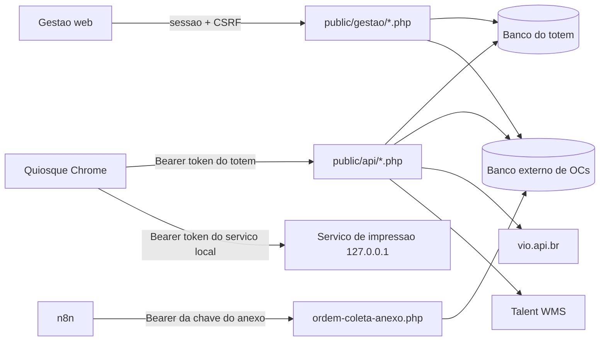

# APIs e integrações do totem-udlog

Documentação das integrações e endpoints **realmente ativos** no código (HEAD `4188fee`, 2026-10-09). O código vence qualquer outro documento. Nenhuma chamada real a VIO, Talent, Serpro ou n8n foi feita para escrever esta documentação, e nenhum teste foi reexecutado. Todos os exemplos são fictícios (hosts `exemplo.invalid`, tokens e dados inventados).

Documentos relacionados: [banco de dados](../banco-dados.md), [regras de negócio](../regras-negocio.md) e os fluxos em [`../fluxos/`](../fluxos/README.md).

## Legenda de confiança

A mesma de [banco-dados.md](../banco-dados.md), com a correspondência pedida para APIs:

| Marca | Significado | Categoria |
|---|---|---|
| **[C]** | Confirmado lendo o código (arquivo e função citados). | IMPLEMENTADO PELO PROJETO |
| **[T: nome]** | Existe teste em `tests/manual/` ou no serviço de impressão que cobre a regra. Não reexecutado aqui; o "passa" vem de registro histórico. | IMPLEMENTADO PELO PROJETO |
| **[A]** | Depende de ambiente ou terceiro (Hostgator, Talent, vio.api.br, n8n, mini PC, banco externo real). Só vale como relato registrado. Quando o relato vem de documento do fornecedor em `docs/`, a linha diz "INFORMADO PELO FORNECEDOR". | INFORMADO PELO FORNECEDOR (quando houver documento) |
| **[P]** | PENDENTE DE CONFIRMAÇÃO. Não verificado; nada foi presumido. | NÃO CONFIRMADO |

## Mapa das integrações ativas

| Documento | O que cobre | Quem chama quem |
|---|---|---|
| [totem-api-interna.md](totem-api-interna.md) | `public/api/atendimento.php`, `cliente.php`, `documento.php`, `lgpd.php`, `nota.php` | navegador do quiosque -> servidor PHP |
| [impressao-servico-local.md](impressao-servico-local.md) | `public/api/impressao.php`, `impressao-teste.php` (diagnóstico) e o serviço Node `servico-impressao-local/` | quiosque -> PHP (gera o PDF) e quiosque -> serviço local no mini PC (imprime) |
| [vio-api-br.md](vio-api-br.md) | validação de CNH/CRLV por QR | PHP -> vio.api.br; o polling é do front, via `documento.php` |
| [talent-checkin.md](talent-checkin.md) | check-in no Talent WMS | PHP -> Talent (`POST /Portaria/Checkin`) |
| [banco-gestao-coletas.md](banco-gestao-coletas.md) | ordens de coleta no banco externo | PHP -> banco externo por PDO (não é HTTP) |
| [n8n-anexo-ordem-coleta.md](n8n-anexo-ordem-coleta.md) | `public/api/ordem-coleta-anexo.php` | n8n -> servidor PHP |
| [gestao-rotas.md](gestao-rotas.md) | páginas e ações de `public/gestao/*.php` | navegador do gestor -> servidor PHP |

Integrações que **não** estão ativas (não documentadas como API):

- Não existe API HTTP de ordens de coleta: o totem lê e escreve o banco externo direto (ver [banco-gestao-coletas.md](banco-gestao-coletas.md)). **[C]**
- `App\Rn\ClienteApiClient` é **código morto**: nenhum `new ClienteApiClient` em `app/`, `public/`, `cron/` ou `util/`. O cadastro usado é `tb_cliente` local. **[C]**
- Serpro: não há integração no código ativo. **[P]** (nada encontrado nas rotas e clientes lidos)

## Convenções gerais das APIs do totem (`public/api/*.php`)

### Ordem de processamento

1. Cada arquivo chama `Bootstrap::conectar`. Falha (env ausente, `DB_*` vazias, erro de PDO) responde **503** `{"sucesso":false,"erro":"Servico temporariamente indisponivel. Tente novamente em instantes."}` **antes** da autenticação. **[C]**
2. `Util\Auth::validarTotem` autentica o totem (abaixo).
3. A ação vem da query `?acao=<nome>`; o corpo é JSON lido de `php://input`.
4. Ação desconhecida: **404** `Acao invalida`. **[C]**

### Autenticação por token do totem

- Cabeçalho `Authorization`, lido por `getallheaders()` nas grafias `Authorization` e `authorization`. O texto `Bearer` é removido e o resto passa por `trim`. **[C]** (`util/Auth.php`)
- Vazio: **401** `Token nao informado`.
- Sem linha em `tb_totem` com `token_api = :token AND ativo = 1` (prepared statement): registra `LogSistema::registrar('totem_nao_autorizado')` e responde **401** `Totem nao autorizado`. **[C]**
- Totem inativo ou desativado = 401 (a linha não casa).
- O `id_totem` do token é o escopo de posse. Toda ação com `id_atendimento` confere `id_totem` do atendimento == totem autenticado; senão **404** `Atendimento nao encontrado` (anti-IDOR). **[C]**
- A autenticação é "Bearer" por convenção do front, mas o código aceita qualquer valor depois de remover a palavra `Bearer`.
- A exceção é `ordem-coleta-anexo.php`, que **não** usa o token do totem (chave própria do n8n; ver [n8n-anexo-ordem-coleta.md](n8n-anexo-ordem-coleta.md)).
- O serviço local de impressão tem token **próprio** (ver [impressao-servico-local.md](impressao-servico-local.md)).

### Formato de resposta (`Util\Resposta`)

| Helper | Corpo | HTTP padrão |
|---|---|---|
| `sucesso` | `{"sucesso":true,"dados":{...}}` | 200 |
| `erro` | `{"sucesso":false,"erro":"<mensagem>"}` | 400 |
| `erroComDados` | `{"sucesso":false,"erro":"...","codigo":"...","dados":{...}}` | 422 |
| `erroComDadosSemCodigo` | `{"sucesso":false,"erro":"...","dados":{...}}` | informado |

`Content-Type: application/json; charset=utf-8`. **[C]** (`util/Resposta.php`). O front (`api()` em `app.js`) trata `sucesso:false` como erro, copiando `status`, `codigo` e `dados` para a exceção, qualquer que seja o HTTP.

### Códigos HTTP usados

| HTTP | Uso nas APIs do totem |
|---|---|
| 200 | sucesso (`dados`) |
| 201 | só `ordem-coleta-anexo.php` (criado/atualizado) |
| 202 | `finalizar` com falha reprocessável do Talent, **com `sucesso:false`** (ver observações) |
| 400 | entrada incompleta/inválida, estado ou etapa errada (padrão de `Resposta::erro`) |
| 401 | token ausente ou inválido |
| 403 | só nas rotas do n8n e da gestão |
| 404 | ação inválida; atendimento/nota inexistente ou de outro totem |
| 405 | só `ordem-coleta-anexo.php` e a gestão |
| 409 | conflito de estado (aceite LGPD inválido, atendimento concluído, check-in em andamento etc.) |
| 413, 422 | `ordem-coleta-anexo.php`; 422 também em `CONFIRMACAO_INCOMPLETA`, `NOTAS_SEM_NUMERO`, `TALENT_SEM_REGISTRO` (`finalizar`), ajudante inválido |
| 429 | rate limits (abaixo) |
| 500 / 502 / 503 | falha interna / falha de integração (OC, VIO) / indisponível ou lock ocupado |

### Rate limits existentes

| Onde | Limite | Resposta |
|---|---|---|
| `documento.php?acao=status-processamento` | mais de 20 chamadas por (atendimento, tipo) em 5 s | 429 + `Retry-After` |
| `nota.php?acao=identificar-cliente` | mais de 30 por totem em 60 s | 429 + `Retry-After`; falha da dependência do limite = 503 (fail-closed) |
| `ordem-coleta-anexo.php` | 10 falhas de autenticação por IP em 900 s | 429 `MUITAS_TENTATIVAS` + `Retry-After: 900` |
| Login da gestão e página do totem (`public/totem/index.php`) | ver [gestao-rotas.md](gestao-rotas.md) | fora das APIs |

**Não existe rate limit de falhas de token nas APIs do totem.** O que existe é throttle da *escrita do log* `totem_nao_autorizado` (1 por categoria a cada 60 s), que não bloqueia ninguém. **[C]**

### Registro de comportamentos reais (sem correção)

Estes pontos foram **observados e registrados, não corrigidos**:

1. **Método HTTP não validado** nos arquivos do totem (qualquer método é aceito; decisão de produto (2026-10-10): não será tratado). O front usa POST com JSON (e `GET` em `cliente.php?acao=buscar`). Só `ordem-coleta-anexo.php` exige POST (405) e a gestão tem lista de métodos por página. **[C]**
2. **`salvar-etapa` com `etapa` desconhecida** responde **200** `{"ok":true}` sem efeito (`switch` sem `default`). **[C]**
3. **Códigos de erro inconsistentes**: `CONFIRMACAO_INCOMPLETA`, `OCR_EM_ANDAMENTO`, `NOTAS_SEM_NUMERO` (em `concluir-digitalizacao`) e `TALENT_SEM_REGISTRO` (em `finalizar`) vão no campo `codigo`; já `TALENT_CHECKIN_DESATIVADO`, `NOTAS_SEM_NUMERO` (em `finalizar`) e `NUMERO_NOTA_DUPLICADO` aparecem **só dentro do texto** de `erro`. **[C]**
4. **HTTP 202 com `sucesso:false`** em `finalizar` (falha reprocessável do Talent). **[C]**
5. **Empresa inativa**: `finalizar` responde **500** `Totem sem empresa/armazem configurado para envio ao Talent` (o `EmpresaDao` filtra `ativo=1`). **[C]**
6. **Sem rate limit de falhas de token** nas APIs do totem (acima). **[C]**
7. `lgpd.php` não captura exceção de banco após a autenticação, e `selecionar-ordem` não captura exceção do banco externo; o que o cliente recebe nesses casos é **[P]**.
8. `AuthServidor::requisicaoHttps` aceita `X-Forwarded-Proto: https`, e o limite do n8n usa `REMOTE_ADDR` (atrás de proxy o IP pode ser o do proxy). Em produção: **[P]**.

**Talent 2xx sem `nrRegAcesso` utilizável (decisão do usuário em 2026-10-11, implementada, não é mais divergência).** Quando o Talent responde HTTP 2xx sem `nrRegAcesso` utilizável (ausente, nulo, não-texto, vazio ou só espaços, corpo não-JSON, não-array ou 204), `TalentClient` lança `TalentClientException('resposta_ilegivel')`; `TalentRn` cancela o atendimento (`talent_checkin_status='ENVIO_INDETERMINADO'`, `status='cancelado'`) e `finalizar` responde **422** com `codigo` `TALENT_SEM_REGISTRO` e `dados.acao='guiche_portaria'`, sem `senha`. Não há `ENVIADO` nem senha nula. Detalhes em [talent-checkin.md](talent-checkin.md) e [totem-api-interna.md](totem-api-interna.md). **[C]**

### Variáveis de ambiente das integrações (só nomes)

`DB_HOST`, `DB_PORT`, `DB_NAME`, `DB_USER`, `DB_PASS`, `GESTAO_COLETAS_DB_NAME`, `STORAGE_PATH`, `TALENT_API_URL`, `TALENT_API_KEY`, `TALENT_CHECKIN_ATIVO`, `CONCLUIR_EXIGE_NUMERO_NOTA`, `VIO_API_BR_BASE_URL`, `VIO_API_BR_API_KEY`, `IMPRESSAO_LOCAL_URL`, `IMPRESSAO_LOCAL_TOKEN`, `IMPRESSAO_FRONTEND_TIMEOUT_MS`, `ETIQUETA_LARGURA_MM`, `ETIQUETA_COMPRIMENTO_MM`, `ETIQUETA_ORIENTACAO`, `ETIQUETA_CORTE_APOS_IMPRESSAO`, `ETIQUETA_AREA_UTIL_MM`, `ORDEM_COLETA_ANEXO_API_KEY`, `ORDEM_COLETA_ANEXO_MAX_BYTES`, `ORDEM_COLETA_ANEXO_PERMITIR_HTTP`, `GESTAO_HASH_SALT`, `TOTEM_URL_BASE`, `GESTAO_PERMITIR_HTTP`. Valores reais nunca entram na documentação.

## Pendências gerais de documentação de APIs

- `docs/db_gestao_coletas.md` mantém "buscar OC por placa" como placeholder e descreve a API HTTP de clientes (código morto) como contrato, enquanto o totem usa SQL direto no banco externo. **[C]**
- Não há teste de rota HTTP, CORS, autenticação ou 409 do serviço de impressão ponta a ponta no repositório. **[C]**
