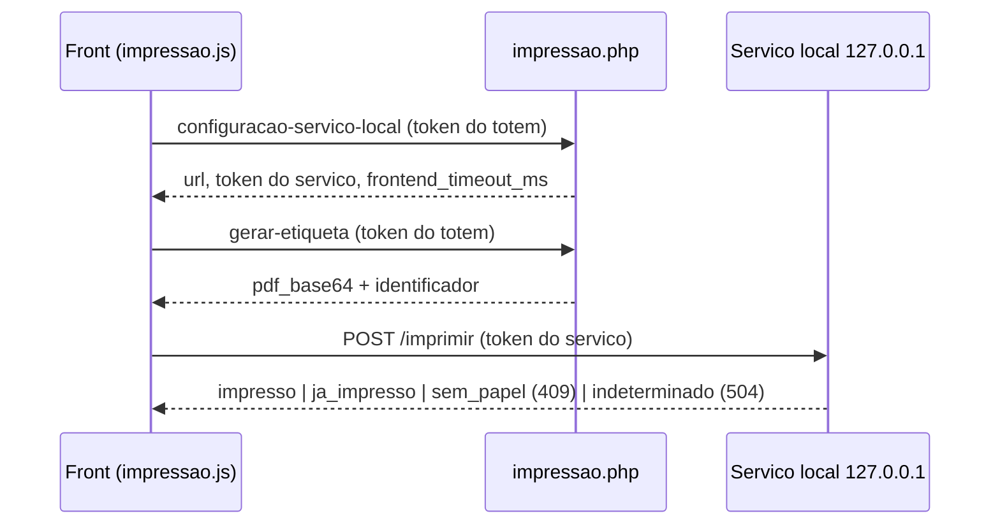

# Impressão: API PHP e serviço local (mini PC)

A etiqueta é gerada no servidor PHP (`public/api/impressao.php`) e impressa por um serviço Node que roda **no mini PC do quiosque** (`servico-impressao-local/`), chamado **direto pelo navegador**. São dois tokens diferentes: o do totem (PHP) e o do serviço local. Convenções gerais: [README.md](README.md). Fluxo funcional: [08 - Impressão de etiquetas](../fluxos/08-impressao-etiquetas.md). Legenda: **[C]** código, **[T: nome]** teste, **[A]** ambiente/terceiro, **[P]** pendente.



## 1. `public/api/impressao.php` (token do totem)

- **URL**: `https://<dominio-do-totem>/api/impressao.php?acao=<acao>`. Método não validado (front usa POST). Auth: token do totem (ver README). Banco indisponível: 503 antes da auth. Ação desconhecida: 404 `Acao invalida`. **[C]**

### `gerar-etiqueta`

- Corpo: `id_atendimento`; `destinatario` (`motorista` padrão | `ajudante`); `reimpressao` (aceita na **query ou no corpo**: `1`, `true` ou `"1"`; só gera log).
- Requisição (fictícia):

```json
{ "id_atendimento": 1001, "destinatario": "motorista" }
```

- Resposta 200:

```json
{
  "sucesso": true,
  "dados": {
    "pdf_base64": "JVBERi0xLjQK...",
    "identificador": "a1b2c3d4e5f60718293a4b5c6d7e8f90",
    "largura_mm": 80,
    "comprimento_mm": 80,
    "orientacao": "portrait",
    "corte_apos_impressao": true,
    "destinatario": "motorista",
    "tem_etiqueta_ajudante": false
  }
}
```

`tem_etiqueta_ajudante` só vem quando `destinatario=motorista`.

- Pré-condições: `status=concluido`, `talent_checkin_status=ENVIADO` e `talent_senha` não vazia.
- Erros:

| HTTP | Texto de `erro` |
|---|---|
| 400 | `Dados incompletos` (sem `id_atendimento`) |
| 422 | `Destinatario invalido: use motorista ou ajudante` |
| 404 | `Atendimento nao encontrado` (inclui outro totem) |
| 409 | `Check-in ainda nao confirmado para este atendimento — nao ha etiqueta para imprimir`; `Este atendimento nao possui ajudante — nao ha etiqueta de ajudante para imprimir` |
| 500 | `Dados da etiqueta incompletos — procure um atendente`; `Nao foi possivel gerar a etiqueta agora`; `Configuracao de etiqueta ausente ou invalida` (variáveis `ETIQUETA_*`) |

- O texto da etiqueta é só ASCII (`Util\TextoEtiqueta::paraAscii`); o CPF nunca é impresso. Etiqueta do ajudante: título `AJUDANTE`; do motorista: `UDLOG`. **[C]** [T: teste_impressao_idor, teste_etiqueta_ajudante, teste_etiqueta_ajudante_qa, teste_texto_etiqueta, teste_mensagem_api_e_flag_reimpressao]
- **Idempotência no PHP: nenhuma.** Cada chamada gera um `identificador` novo (32 hex, `random_bytes`). A idempotência de impressão está no serviço local (seção 2). **[C]**
- Fail-closed: sem check-in confirmado ou com configuração de etiqueta inválida, não gera PDF.

### `configuracao-servico-local`

- Sem parâmetros. 200 `{"url":"http://127.0.0.1:4747","token":"TOKEN_FICTICIO_DO_SERVICO","frontend_timeout_ms":35000}`, com `Cache-Control: no-store`. Valores vêm de `IMPRESSAO_LOCAL_URL`, `IMPRESSAO_LOCAL_TOKEN`, `IMPRESSAO_FRONTEND_TIMEOUT_MS` (numérico maior que 0).
- Erro: **503** `Servico local de impressao nao configurado` (variável ausente/inválida; registra `impressao_config_falhou`).
- **Fato de desenho**: esta ação entrega o **token do serviço local ao navegador** do totem (aceito pelo usuário, state de 2026-10-06). **[C]** [A]

## 2. `public/api/impressao-teste.php` (diagnóstico)

Rota de diagnóstico, mantida por decisão do usuário (state, higienização de 2026-10-09). Auth: **token do totem** (mesma regra). Não toca `tb_atendimento`. Usada por `public/totem/assets/diagnostico-impressao.js`. **[C]**

| Ação | Corpo | Resposta / erros |
|---|---|---|
| `gerar-etiqueta` | opcional: `largura_mm` e `comprimento_mm` (20 a 300), `orientacao` (`portrait`\|`landscape`), `destinatario` | 200 com `pdf_base64`, `identificador`, `largura_mm`, `comprimento_mm`, `orientacao`, `corte_apos_impressao`, `pagina_gerada_mm`, `destinatario`; 422 em valor inválido; 500 `Nao foi possivel gerar a etiqueta de teste agora` ou `Configuracao de etiqueta ausente ou invalida` |
| `configuracao-servico-local` | nenhum | igual ao de `impressao.php` (sem log), 503 se não configurado |
| `configuracao-etiqueta` | nenhum | 200 com a configuração `ETIQUETA_*` (`no-store`) |
| `etiqueta-pronta` | nenhum | 200 com `pdf_base64`, `identificador`, `origem:"docs/50x80.pdf"`, `pagina_gerada_mm`; **404** `Arquivo docs/50x80.pdf nao encontrado no servidor` se ausente; 500 se não for PDF |

- Se a pasta `docs/` existe no servidor de produção é **[P]** (o próprio código já registra que o arquivo fixo pode não existir no deploy).

## 3. Serviço local de impressão (Node/Express, mini PC)

Diretório `servico-impressao-local/`. Escuta **somente em `127.0.0.1`** (host fixo em `src/config.js`), na porta de `config/config.json` (exemplo: 4747). Impressão por SumatraPDF via `pdf-to-printer`. **[C]**

### 3.1 Configuração (`config/config.json`, sem valores reais aqui)

| Campo | Regra |
|---|---|
| `porta` | inteiro de 1 a 65535 |
| `token` | string com pelo menos 16 caracteres; o valor de exemplo é recusado |
| `maxPdfBytesDecodificado` | inteiro positivo (exemplo: 2097152) |
| `origensPermitidas` | lista de origens exatas (pode ser vazia; vazia = nenhum navegador autorizado, fail-closed) |
| `impressorasPermitidas` | **allowlist obrigatória e não vazia**; nome exato do driver; vazia impede a subida |
| `timeoutMs` | opcional, padrão 30000 |
| `printSettings` | opcional, padrão `noscale,portrait,paper=totem`; só `[A-Za-z0-9,=._ -]` |
| `deteccaoSemPapel` | opcional, padrão `true` |
| `semPapelTimeoutMs` | opcional, 3000 a 60000, padrão 10000 |
| `idempotencia` | `{ttlMs, maxEntries}` (exemplo: 600000 e 500) |

A origem de produção do quiosque e o nome do driver/porta em produção são relato do usuário no state (origem `https://<dominio-do-totem>`, TM-T88VII, `Receipt6`/`TMUSB001`); o `config.json` real não foi lido. **[A]** **[P]**

### 3.2 Autenticação e CORS

- Token próprio: `Authorization: Bearer <token-do-servico>` (exatamente duas partes, `Bearer` + token). Comparação por sha256 + `timingSafeEqual`. Falha: **401** `{"erro":"Token de autenticacao ausente ou invalido."}`. **[C]**
- CORS e Private Network Access (`src/middleware/cors.js`), aplicados antes de qualquer rota:
  - Com `Origin` autorizada (igual a um item de `origensPermitidas`): `Access-Control-Allow-Origin` com a origem e `Vary: Origin`; `Access-Control-Allow-Private-Network: true` se o pré-voo pedir.
  - `OPTIONS`: **204** (métodos `GET, POST, OPTIONS`; cabeçalhos `Content-Type, Authorization`; `Max-Age` 600) ou **403** sem corpo se a origem não for autorizada.
  - Qualquer método com `Origin` não autorizada: **403** `{"erro":"Origem nao autorizada (CORS)."}`.
  - Sem `Origin` (curl local): passa, e a autenticação continua valendo.

### 3.3 Rotas

| Rota | Auth | Resposta |
|---|---|---|
| `GET /saude` | **não** | 200 `{"status":"ok","servico":"servico-impressao-local","versao":"x.y.z"}` |
| `GET /impressoras` | Bearer | 200 `{"impressoras":[{"nome":"EPSON TM-T88VII Receipt","padrao":true}]}` (só as da allowlist); 500 `Nao foi possivel listar as impressoras.` |
| `POST /imprimir` | Bearer | ver abaixo |
| qualquer outra | não | 404 `{"erro":"Rota nao encontrada."}` |

Erros não tratados (inclusive JSON malformado ou corpo acima de 32 MB no `express.json`) caem no tratador final e viram **500** `{"erro":"Erro interno do servico."}`. **[C]**

### 3.4 `POST /imprimir`

- Corpo JSON (limite 32 MB): `impressora` (nome, até 256 caracteres, sem `/` nem `\`), `identificador` (`^[A-Za-z0-9_-]+$`, até 128), `pdf_base64`.
- Requisição (fictícia):

```json
{ "impressora": "EPSON TM-T88VII Receipt", "identificador": "a1b2c3d4e5f60718293a4b5c6d7e8f90", "pdf_base64": "JVBERi0xLjQK..." }
```

- Ordem de verificação: autenticação, validação do corpo, idempotência, allowlist da impressora, validação do PDF, trava global de job.

| HTTP | Corpo | Quando |
|---|---|---|
| 200 | `{"status":"impresso","identificador":"..."}` | impressão concluída |
| 200 | `{"status":"ja_impresso","identificador":"...","mensagem":"..."}` | identificador já impresso (impressão duplicada ignorada) |
| 200 | `{"status":"indeterminado","identificador":"...","mensagem":"..."}` | identificador marcado como indeterminado antes |
| 400 | `{"erro":"..."}` | corpo ausente/inválido; `impressora` ou `identificador` inválidos; `pdf_base64` vazio, não decodificável, maior que `maxPdfBytesDecodificado` ou sem `%PDF` |
| 401 | `{"erro":"Token de autenticacao ausente ou invalido."}` | token |
| 403 | `{"erro":"Impressora nao permitida."}` | fora da allowlist |
| **409** | `{"status":"sem_papel","identificador":"...","job_removido":true}` | job ficou na fila do spooler além do limite |
| 500 | `{"erro":"Falha ao imprimir."}` | outro erro de impressão |
| 503 | `{"erro":"Outro job de impressao esta em andamento neste dispositivo. Tente novamente em instantes."}` | já há um job (**lock global de 1 job**) |
| **504** | `{"status":"indeterminado","identificador":"...","codigo":"IMPRESSAO_TIMEOUT","erro":"..."}` | estouro de `timeoutMs` |

### 3.5 Timeouts, retry e idempotência

- **Timeout do job** (`timeoutMs`, padrão 30 s): ao estourar, o serviço encerra só o processo do job (`taskkill /PID <pid> /T /F`, nunca por nome), marca o identificador como `indeterminado` e responde 504. **[C]**
- **Timeout do front** (`IMPRESSAO_FRONTEND_TIMEOUT_MS`, entregue por `configuracao-servico-local`; o front usa 35000 ms só como reserva se o valor não for um número positivo): `AbortController` no `fetch` de `/imprimir`. Aborto ou falha de rede = estado **indeterminado** na tela, nunca sucesso. **[C]**
- **Sem retry automático** em nenhuma camada. "Tentar novamente" é sempre clique do usuário e **gera uma etiqueta nova** (`gerar-etiqueta` com `reimpressao=1`, novo `identificador`, novo job). Resultado **indeterminado não é repetido** com o mesmo identificador: a resposta repete `indeterminado` até o registro expirar. **[C]**
- **Idempotência em memória** (`IdempotenciaStore`, TTL e `maxEntries` da configuração): perde-se ao reiniciar o serviço. **[C]**
- **Falta de papel** (`deteccaoSemPapel`): depois de imprimir, observa a fila (PowerShell `Get-PrintJob`, consulta a cada 500 ms, janela de visão de 3 s). Se o job (identificado pelo nome base do arquivo temporário) continuar na fila após `semPapelTimeoutMs`, remove só esse job e responde **409 `sem_papel`** **sem** marcar o identificador como impresso (o mesmo identificador pode ser reenviado). Falha ao consultar a fila mantém `impresso`. Validado fisicamente em produção apenas por relato do usuário no state (EPSON TM-T88VII `Receipt6`/`TMUSB001`). **[C]** **[A]**
- Front, ao receber `sem_papel`: tela própria com "Tentar novamente" (só reimpressão, sem limite de tentativas); com ajudante, imprime em seguida a etiqueta do ajudante e só então conclui; a nova tentativa reimprime só a etiqueta pendente. **[C]**

### 3.6 Testes e limites do que está provado

- `npm test` em `servico-impressao-local/` cobre listagem de impressoras, `printSettings`, `verificarFila` e `verificarFila` por caminho (33/33 segundo o state; não reexecutado aqui). **[T]**
- **Não existe teste de rota HTTP, CORS, autenticação ou 409 ponta a ponta** no repositório. **[P]**
- `GET /saude` não exige token (só alcançável em `127.0.0.1`).

### 3.7 Indisponibilidade

Serviço fora do ar, porta errada ou origem não autorizada = `fetch` falha no navegador; o front mostra erro de serviço offline ou de listagem de impressoras, e o atendimento permanece concluído (o check-in já foi confirmado antes da impressão). **[C]**
