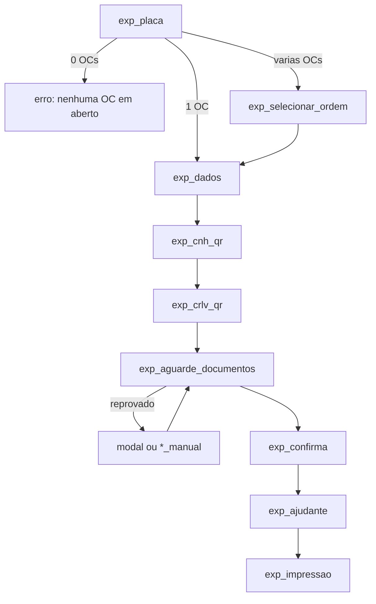

# 02 - Expedição

Índice: [fluxos](README.md) | API: [totem-api-interna](../apis/totem-api-interna.md) | [regras de negócio](../regras-negocio.md) | [banco de dados](../banco-dados.md)

## Objetivo

Check-in do motorista que vai **retirar** carga: identificar a ordem de coleta (OC) pela placa, validar CNH e CRLV, confirmar dados, registrar ajudante, enviar ao Talent, imprimir etiquetas e baixar a OC. `[CÓDIGO]`

## Atores

Motorista; quiosque; backend; banco externo de coletas; vio.api.br; Talent WMS; serviço local de impressão. `[AMBIENTE-TERCEIRO]` para os externos.

## Pré-condições

- Aceite LGPD válido ([fluxo 01](01-lgpd-e-inicio-atendimento.md)).
- Totem ativo com empresa ATIVA (exigido no `finalizar`). `[CÓDIGO]`

## Etapas do motorista

1. `exp_placa`: digita a placa. 0 OCs: mensagem "Nenhuma ordem de coleta em aberto para essa placa"; falha na consulta: "Nao foi possivel consultar as ordens de coleta agora". 1 OC: vai direto a `exp_dados`. Várias: `exp_selecionar_ordem`. `[CÓDIGO]`
2. `exp_selecionar_ordem` (só com várias OCs): escolhe a OC.
3. `exp_dados` ("Dados da ordem - toque para editar"): Cliente, CNPJ, Placa, Veículo e Ordem de coleta. Toca avançar.
4. `exp_cnh_qr` e `exp_crlv_qr`: aponta o QR do documento (fluxo [05](05-cnh-crlv-qr-vio.md)). CNH e CRLV processam em paralelo.
5. `exp_aguarde_documentos`: espera a validação; se reprovado, modal com "Escanear novamente", "Preencher manualmente" ou "Cancelar atendimento".
6. `exp_confirma`: cartões Motorista, Veículo e Atendimento; Placa e Ordem somente leitura; confirma.
7. `exp_ajudante`: "Possui ajudante?" Não, ou Sim com nome e CPF.
8. `exp_impressao`: envio ao Talent, senha na tela e impressão (fluxos [07](07-checkin-talent.md) e [08](08-impressao-etiquetas.md)).

## Processamento interno

- `iniciar`: cria o atendimento e consulta OCs ATIVAS da placa no banco externo (fluxo [06](06-consulta-e-baixa-ordem-coleta.md)). Com 1 OC grava `ordem_coleta`, `cliente_nome`, `cliente_cnpj` (valores do banco externo) e etapa `dados_encontrados`. `[CÓDIGO]`
- `selecionar-ordem`: exige Expedição, `em_andamento` e etapa `placa`; **revalida no servidor** que o número está entre as OCs reais da placa. `[CÓDIGO]`
- `avancar-etapa-documentos`: percorre `dados_encontrados` -> `exp_cnh` -> `exp_crlv` -> `exp_aguarde_documentos` -> `exp_confirmacao`; a entrada em `exp_confirmacao` exige CNH e CRLV aprovados e devolve `dados_confirmacao` (motorista, CPF, validade, ano, UF, RNTRC, tipo). `[CÓDIGO]`
- `salvar-etapa` `confirmacao`: exige etapa `exp_confirmacao`; valida placa, nome, CPF válido com dígito verificador, validade, ano, UF (27), RNTRC (1 a 20), tipo (1 a 60) e OC não vazia; senão 422 `CONFIRMACAO_INCOMPLETA` com `campos` e `rotulos`. Se o motorista alterou algum campo vindo da VIO, a origem do documento é rebaixada para MANUAL com `PENDENTE_REVISAO`. `[CÓDIGO]`
- `salvar-etapa` `ajudante`: nome até 150 e CPF de 11 dígitos (sem verificação de dígito, decisão do usuário); gravação sob `SELECT ... FOR UPDATE` e só com Talent em `NAO_ENVIADO` ou `ERRO_REPROCESSAVEL`, senão 409. `[CÓDIGO]` `[TESTE: teste_talent_correcao_ajudante]`
- `finalizar` e etiquetas: fluxos 07 e 08. Após ENVIADO, baixa da OC (fluxo 06).

## Endpoints envolvidos

`atendimento.php` (`iniciar`, `selecionar-ordem`, `avancar-etapa-documentos`, `salvar-etapa`, `finalizar`, `cancelar`), `documento.php`, `impressao.php`. Ver [totem-api-interna](../apis/totem-api-interna.md). O alias `avancar-etapa-expedicao` existe mas o front usa `avancar-etapa-documentos`. `[CÓDIGO]`

## Mudanças de estado

`placa` -> `dados_encontrados` -> `exp_cnh` -> `exp_crlv` -> `exp_aguarde_documentos` -> `exp_confirmacao` -> `impressao` com `status=concluido` quando o Talent confirma ENVIADO. **Divergência do código:** `impressao` é gravada pelo CAS do Talent (que marca `concluido`) e também por `avancar-etapa-documentos` em `exp_confirmacao` (`status=em_andamento`, sem Talent; rota não usada pelo front); não é regra desejada. `[CÓDIGO]`

## Integrações

Banco externo de OCs (06), vio.api.br (05), Talent (07), serviço local de impressão (08), anexo da OC do n8n (10). `[AMBIENTE-TERCEIRO]`

## Conclusão

`status=concluido`, `etapa=impressao`, `talent_senha` = `nrRegAcesso` do Talent; o motorista vê o "Número de acesso", recebe as etiquetas e aguarda ser chamado. Se o Talent não devolver o número de registro (2xx sem `nrRegAcesso`), não há conclusão: o atendimento é cancelado e o motorista vai ao guichê da portaria ([07](07-checkin-talent.md)). `[CÓDIGO]`

## Cancelamento

Botão "Cancelar atendimento" em toda tela exceto `home`/`lgpd`; inatividade 180 s + aviso 30 s; ver [09](09-cancelamento-e-abandono.md).

## Falhas e alternativas

- Documento reprovado: re-escaneio (até a 3ª falha) ou preenchimento manual com as mesmas validações; ver 05.
- Talent recusa: HTTP 202 com mensagem; nova tentativa manual; ver 07.
- Talent responde 2xx sem número de registro: atendimento `cancelado`, OC **não** baixada (continua ATIVA) e tela "Dirija-se ao guichê da portaria"; sem etiqueta; ver 07 e 08.
- Impressão sem papel ou falha: reimpressão; ver 08.
- Falha na baixa da OC: não desfaz o check-in; vira pendência de baixa; ver 06.
- Operação concorrente: CAS no envio VIO, CAS do Talent. `[CÓDIGO]`

## Pendências conhecidas

- **Edições em `exp_dados` não persistem**: a tela permite editar Cliente, CNPJ, Placa, Veículo e OC, mas `avancarDados` só envia `id_atendimento` ao backend; o backend segue com os valores do banco externo e Placa/Veículo/OC editadas nem são lidas. `[CÓDIGO]`
- 0 OCs ou falha de consulta deixam atendimento `em_andamento` em `placa` até cancelar ou abandono. `[CÓDIGO]`
- `selecionar-ordem` sem tratamento de exceção do banco externo (resposta `[PENDENTE DE CONFIRMAÇÃO]`).
- P22 (veículo sem RNTRC), P24 (fixture do teste de consulta), P25, P48 e P49 do state.
