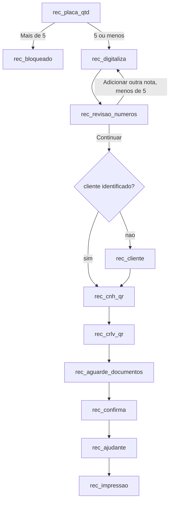

# 03 - Recebimento

Índice: [fluxos](README.md) | API: [totem-api-interna](../apis/totem-api-interna.md) | [regras de negócio](../regras-negocio.md) | [banco de dados](../banco-dados.md)

## Objetivo

Check-in do motorista que vai **entregar** carga: digitalizar até 5 notas fiscais, identificar o cliente, validar CNH e CRLV, confirmar, enviar ao Talent e imprimir etiquetas. O Recebimento **não** consulta nem baixa OC. `[CÓDIGO]`

## Atores

Motorista; quiosque com scanner Netum SD-2000 (câmera USB) e Tesseract.js no navegador; backend; vio.api.br; Talent; serviço local de impressão. `[AMBIENTE-TERCEIRO]` para scanner e externos.

## Pré-condições

Aceite LGPD válido ([01](01-lgpd-e-inicio-atendimento.md)); totem ativo com empresa ATIVA. `[CÓDIGO]`

## Etapas do motorista

1. `rec_placa_qtd`: placa (o campo aceita no máximo 7 caracteres e o front exige exatamente 7; o backend não valida o formato) e "5 ou menos" / "Mais de 5". "Mais de 5" chama `bloquear-excesso-notas` e abre `rec_bloqueado` ("Esse atendimento precisa ser concluido no balcao da portaria"). `[CÓDIGO]`
2. `rec_digitaliza`: captura cada nota (detalhes no fluxo [04](04-notas-e-ocr.md)); "Finalizar digitalização" habilita com 1 nota ou mais; com 5 notas a captura é desabilitada.
3. `rec_revisao_numeros`: confirma o número de cada nota; "Continuar" só habilita com todas confirmadas.
4. `rec_cliente` (somente se o cliente não foi identificado pelo OCR): autocomplete a partir de 3 letras; só aceita cliente **selecionado da lista**.
5. `rec_cnh_qr`, `rec_crlv_qr`, `rec_aguarde_documentos`: fluxo [05](05-cnh-crlv-qr-vio.md).
6. `rec_confirma`, `rec_ajudante`, `rec_impressao`: como na [Expedição](02-expedicao.md), com Cliente somente leitura na confirmação.

## Processamento interno

- `iniciar` (recebimento): sem consulta de OC; responde `proxima_tela=quantidade_notas`. `salvar-etapa` `digitalizacao_notas` (exige etapa `placa`) leva a etapa para `digitalizacao_notas`. `[CÓDIGO]`
- O bloqueio ">5" é decidido pela escolha do motorista na tela; o backend também trava por contagem (nota 6 recusada; `concluir-digitalizacao` recusa mais de 5). `[CÓDIGO]`
- `concluir-digitalizacao` define a próxima etapa: `rec_cnh` se o cliente foi identificado (grava o cliente do atendimento), senão `cliente`. `[CÓDIGO]`
- `salvar-etapa` `cliente`: exige etapa `cliente`, valida o CNPJ e o cadastro ATIVO em `tb_cliente`; grava nome e CNPJ do **banco** e avança para `rec_cnh`. Texto livre envia CNPJ nulo e é recusado (400 "Cliente invalido ou nao cadastrado"). `[CÓDIGO]`
- Sequência de documentos: `rec_cnh` -> `rec_crlv` -> `rec_aguarde_documentos` -> `rec_confirmacao`. A confirmação do Recebimento exige `cliente_nome`. `[CÓDIGO]`
- `finalizar`: exige todas as notas com `numero_nota` (422 `NOTAS_SEM_NUMERO`); o Talent recebe um documento `NOTA_FISCAL` por nota e o PDF de cada nota como anexo. `[CÓDIGO]`

## Endpoints envolvidos

`atendimento.php`, `nota.php`, `cliente.php?acao=buscar`, `documento.php`, `impressao.php`. Ver [totem-api-interna](../apis/totem-api-interna.md).

## Mudanças de estado

`placa` -> `digitalizacao_notas` -> (`cliente` ->) `rec_cnh` -> `rec_crlv` -> `rec_aguarde_documentos` -> `rec_confirmacao` -> `impressao`/`concluido`. Bloqueio: `status=bloqueado`, `etapa=balcao_portaria`. `[CÓDIGO]`

## Integrações

Tesseract.js (cliente), `tb_cliente` local, vio.api.br, Talent, impressão. `[AMBIENTE-TERCEIRO]`

## Conclusão

Igual à Expedição: senha (`nrRegAcesso`) e etiquetas; `status=concluido`. Se o Talent responder 2xx sem número de registro, o atendimento é cancelado (fotos das notas em quarentena) e o motorista vai ao guichê da portaria ([07](07-checkin-talent.md), [08](08-impressao-etiquetas.md)). `[CÓDIGO]`

## Cancelamento

Ver [09](09-cancelamento-e-abandono.md). Cancelar ou abandonar move as fotos das notas para quarentena.

## Falhas e alternativas

- Mais de 5 notas: balcão da portaria (`bloqueado`). `[CÓDIGO]`
- Cliente não identificado: `rec_cliente`. Cliente inativo não identifica. `[CÓDIGO]`
- Falhas de documento, Talent e impressão: fluxos 05, 07 e 08.

## Pendências conhecidas

- **`finalizar` não exige cliente no Recebimento**: um registro de 02/10 dizia que o `finalizar` exigiria também o cliente; no código só a confirmação (`camposObrigatoriosAusentes`) exige `cliente_nome`. O CNPJ do depositante é validado ao montar o payload do Talent (falha vira `ERRO_REPROCESSAVEL`/`erro_montagem_payload`). `[CÓDIGO]`
- `CONCLUIR_EXIGE_NUMERO_NOTA`: padrão `false`; decisão do usuário em 2026-10-11 de ativar em produção (valor no servidor a confirmar): ver fluxo 04.
- Papel emitente/destinatário não implementado: ver fluxo 04.
- Captura de notas sem interrupção (P01 a P16): implementações 2 e 3 não iniciadas; testes físicos pendentes. `[PENDENTE DE CONFIRMAÇÃO]`
- Chave de acesso da nota é sempre nula no payload (P26).
