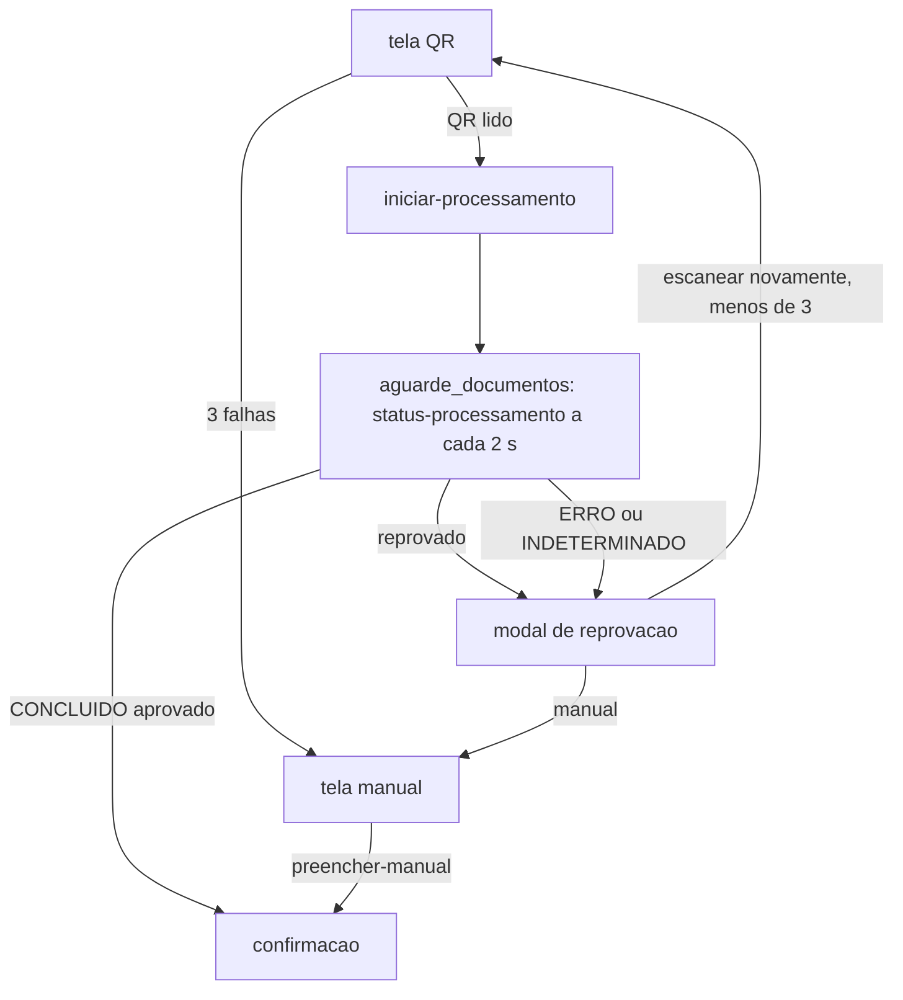

# 05 - CNH, CRLV, QR e vio.api.br

Índice: [fluxos](README.md) | API: [totem-api-interna](../apis/totem-api-interna.md), [vio-api-br](../apis/vio-api-br.md) | [regras de negócio](../regras-negocio.md) | [banco de dados](../banco-dados.md)

Legenda de confiança: ver [README](README.md#legenda-de-confiança).

## Objetivo

Obter e validar os dados do motorista (CNH) e do veículo (CRLV) lendo o QR dos documentos no quiosque e consultando a vio.api.br, com fallback de preenchimento manual. Vale para Expedição e Recebimento. `[CÓDIGO]`

## Atores

Motorista; câmera do quiosque; jsQR (navegador); backend (`DocumentoController`, `DocumentoRn`, `VioApiBrClient`); vio.api.br `[AMBIENTE-TERCEIRO]`.

## Pré-condições

Atendimento `em_andamento` e etapa permitida: CNH em `exp_cnh`/`exp_crlv`/`exp_aguarde_documentos` (ou os `rec_*` equivalentes); CRLV em `exp_crlv`/`exp_aguarde_documentos` (ou `rec_*`). No Recebimento, após notas e cliente ([04](04-notas-e-ocr.md)). `[CÓDIGO]`

## Etapas do motorista

1. `*_cnh_qr`: posiciona o QR da CNH digital no guia da câmera e toca para ler. O front tenta até 3 quadros por toque (intervalo 150 ms, orçamento de 300 ms por quadro, watchdog de 4 s). `[CÓDIGO]`
2. Achou o QR: o front envia o quadro JPEG (qualidade 0,85, base64) ao backend e avança; `*_crlv_qr` repete para o CRLV. CNH e CRLV processam em paralelo. `[CÓDIGO]`
3. `*_aguarde_documentos`: o front consulta o status a cada 2 s, com teto de 125 s. Se ambos aprovados, segue para a confirmação. `[CÓDIGO]`
4. Não achou o QR: contador de tentativas por tipo; na 3ª falha abre `*_manual`.
5. Reprovado: modal "CNH/CRLV não aprovado" com mensagem fixa e botões "Escanear novamente" (só se `qrTentativas + 1 < 3`), "Preencher manualmente" e "Cancelar atendimento". Na 3ª tentativa só manual. `[CÓDIGO]`

## Processamento interno

### Envio (`documento.php?acao=iniciar-processamento`)

- Exige tipo `cnh`/`crlv` e JPEG data URL válido (mesmas travas de 5 MiB, 5000 px e GD); senão 400 "Imagem do QR inválida". Corpo acima de 8 MiB: 400. `[CÓDIGO]`
- Se o documento já está aprovado, devolve o estado atual sem nova chamada. `[CÓDIGO]`
- **CAS `iniciarEnvioVioApiBr`:** só entra se o status é `PENDENTE` ou `ERRO`, ou se está `CONCLUIDO` com origem `NAO_VALIDADO` e sem `*_validado_em` (reprovado reabrível). Há `GET_LOCK` adicional não bloqueante. `[CÓDIGO]`
- Um único POST para `/api/qrcode/read` (imagem em base64, nome do arquivo, `comparar=true`, header `X-API-Key`), sem retry. Conexão 5 s, total 20 s, resposta até 10 MiB. `[CÓDIGO]` `[AMBIENTE-TERCEIRO]` Detalhes em [vio-api-br](../apis/vio-api-br.md).
- Resposta 200/201/202 com `id`: grava o id externo e o status `PROCESSANDO_LEITURA`. Falha ambígua (timeout após conexão, 5xx, resposta sem `id`): `INDETERMINADO`. 401/403/400/422 ou sem conexão: `ERRO` (HTTP 502/503 ao front). `[CÓDIGO]`
- **O JPEG do QR não é gravado em disco nem enviado ao Talent.** `[CÓDIGO]`

### Consulta (`documento.php?acao=status-processamento`)

- Rate limit de 20 requisições por 5 s por (atendimento, tipo): 429. `[CÓDIGO]`
- Processamento acima de 120 s: `INDETERMINADO`. Em `PROCESSANDO_LEITURA`/`COMPARACAO` com id externo, consulta GET `/api/qrcode/result/<id>`: sem resposta => `ERRO`; `nao_encontrado`/`ambiguo` => `INDETERMINADO`; ok => processa o resultado. `[CÓDIGO]`
- A resposta traz `terminal`, `pode_avancar`, `origem`, `status_processamento` e `motivo_usuario` (aditivo, não persistido, só na chamada que efetiva o terminal reprovado): `placa_divergente`, `cnh_vencida`, `documento_ilegivel`, `dados_invalidos` ou nulo. `[CÓDIGO]`

### Regras de aprovação automática (origem `VIO_API_BR`)

- Resposta aprovável: estado de leitura `completed`, `qr_type` = `vio` e `dados_leitura` em formato de array. `[CÓDIGO]`
- **CNH:** nome não vazio e não placeholder, CPF válido com dígito verificador, validade válida e **não vencida** (o próprio dia da validade ainda vale). `[CÓDIGO]`
- **CRLV:** exercício inteiro até 32767, UF entre as 27, valores não placeholder e **placa do CRLV igual à placa do atendimento**; RNTRC e Tipo são opcionais na leitura (P22). `[CÓDIGO]`
- Placeholder: texto não string ou todos os caracteres iguais (dígito único conta como placeholder, P42). `[CÓDIGO]`
- A comparação (`compare`) é só diagnóstica e não decide; `comparacao.campos` sempre veio vazio (P21). `[CÓDIGO]`
- Gravação atômica com CAS por `tentativa_id`; tentativa obsoleta => `persistencia_nao_vigente`. Reprovação grava `CONCLUIDO` com origem `NAO_VALIDADO` (permite re-escaneio); erro, ambiguidade e ausência são fail-closed. Um log `vio_reprovado` só com códigos/chaves, sem valores. `[CÓDIGO]`

### Fallback manual (`documento.php?acao=preencher-manual`)

CNH (nome, CPF, validade) ou CRLV (placa, exercício, UF, RNTRC, tipo). Passa pelas **mesmas** validações, com origem `MANUAL` e `status_revisao=PENDENTE_REVISAO`; CNH vencida e placa divergente também são recusadas. RNTRC/tipo vazios herdam do snapshot se a origem atual é VIO. No front a tela manual só confere campos não vazios e CPF com 11 dígitos. `[CÓDIGO]`

### Rebaixamento para MANUAL na confirmação

`salvar-etapa` da confirmação (`salvarDadosMotorista`) compara os campos da tela com o snapshot da VIO. Origem VIO com qualquer campo diferente (nome, CPF em dígitos, validade; placa, ano, UF; RNTRC/tipo só se o snapshot tinha valor) vira `MANUAL` + `PENDENTE_REVISAO`. Digitar o que a VIO não trouxe não rebaixa. `[CÓDIGO]` `[TESTE: teste_vio_api_br_regras_crlv_e_rebaixamento]`

## Endpoints envolvidos

`documento.php` (`iniciar-processamento`, `status-processamento`, `preencher-manual`) e `atendimento.php` (`avancar-etapa-documentos`, `salvar-etapa`). O gate `ambos_aprovados` exige CNH e CRLV aprovados. Ver [totem-api-interna](../apis/totem-api-interna.md) e [vio-api-br](../apis/vio-api-br.md).

## Mudanças de estado

Etapas: `exp_cnh` -> `exp_crlv` -> `exp_aguarde_documentos` -> `exp_confirmacao` (Recebimento: `rec_*`). Processamento: `PENDENTE`, `ENVIANDO`, `PROCESSANDO_LEITURA`, `PROCESSANDO_COMPARACAO`, `CONCLUIDO`, `ERRO`, `INDETERMINADO`. Origem gravada hoje: `VIO_API_BR` e `MANUAL`; `VIO_TRIAL`, `VIO_VALIDADO`, `VIO_CACHE` e `NAO_VALIDADO` (este último usado na reprovação) são legado/aceitos na leitura. `[CÓDIGO]`

## Integrações

vio.api.br `[AMBIENTE-TERCEIRO]`. O comportamento está comprovado pelo código (`app/Rn/VioApiBrClient.php`) e pelos testes `teste_vio_api_br_client` e `teste_status_processamento` (detalhes em [vio-api-br](../apis/vio-api-br.md)).

## Conclusão

CNH e CRLV aprovados (VIO ou manual válido) liberam `exp_confirmacao`/`rec_confirmacao`. Dados persistidos em texto plano em `tb_atendimento` (nome, CPF, validade, placa, ano, UF, RNTRC, tipo e snapshots), sem rotina de retenção (decisão de produto em 2026-10-10: não será tratado).

## Cancelamento

Modal de reprovação e telas de documento têm "Cancelar atendimento" ([09](09-cancelamento-e-abandono.md)). Ao iniciar novo atendimento no mesmo totem, processamentos VIO pendentes de outros atendimentos `em_andamento` viram `INDETERMINADO`. `[CÓDIGO]`

## Falhas e alternativas

- QR ilegível: 3 tentativas, depois manual.
- Timeout/erro da VIO: `ERRO`/`INDETERMINADO` => reprovação com opção de re-escanear ou manual.
- Documento vencido ou placa divergente: reprovado com motivo ao usuário.

## Pendências

- **Sem limite de re-escaneio no backend (P52):** o limite de 3 é só do front; `iniciarEnvioVioApiBr` aceita novo POST enquanto `CONCLUIDO`+`NAO_VALIDADO`, sem rate limit próprio.
- RNTRC ausente (P22), comparação sem campos (P21), placeholder de dígito único (P42).
- Cache da VIO (`VioCacheDao`, tabelas de cache) existe mas `DocumentoRn` não o chama; `ClienteApiClient` é código morto. Registrado sem correção.
- `teste_status_processamento` instável por timing (P23).
