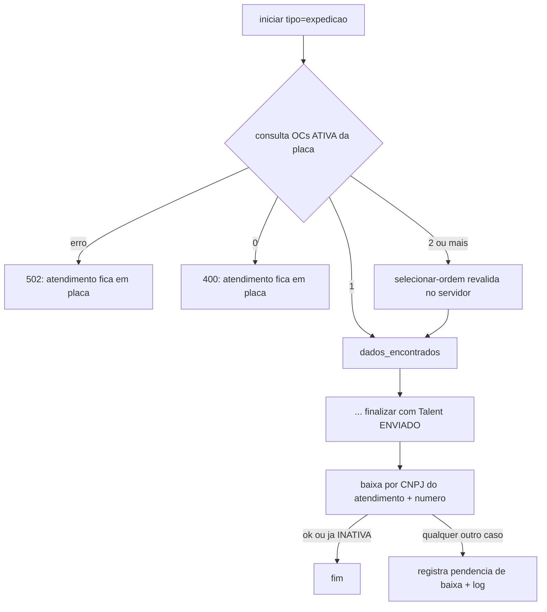

# 06 - Consulta e baixa de ordem de coleta

Índice: [fluxos](README.md) | API: [totem-api-interna](../apis/totem-api-interna.md), [banco-gestao-coletas](../apis/banco-gestao-coletas.md) | [regras de negócio](../regras-negocio.md) | [banco de dados](../banco-dados.md)

Legenda de confiança: ver [README](README.md#legenda-de-confiança).

## Objetivo

Na **Expedição**: localizar as ordens de coleta (OC) ativas da placa no banco externo de coletas e, depois do check-in no Talent, dar baixa na OC (marcá-la INATIVA). O Recebimento não consulta nem baixa OC. `[CÓDIGO]`

## Atores

Motorista; backend (`AtendimentoController`, `OrdemColetaClient`, `OrdemColetaDao`, `OrdemColetaPendenteBaixaDao`); banco externo `<CONTA_CPANEL>_db_gestao_coletas` `[AMBIENTE-TERCEIRO]`; Gestão (resolução manual de baixas pendentes, fora deste fluxo).

## Pré-condições

Consulta: `iniciar` de Expedição com placa. Baixa: check-in Talent `ENVIADO`/`JA_ENVIADO` ([07](07-checkin-talent.md)). Conexão, credenciais e privilégio de escrita no banco externo: `[AMBIENTE-TERCEIRO]`.

## Etapas do motorista

1. `exp_placa`: digita a placa e confirma. `[CÓDIGO]`
2. Uma OC: segue direto para `exp_dados`. Várias: `exp_selecionar_ordem` e escolhe uma. Nenhuma: mensagem "Nenhuma ordem de coleta em aberto para essa placa" (400). Banco externo fora: "Não foi possível consultar as ordens de coleta agora" (502). `[CÓDIGO]`
3. `exp_dados` exibe Cliente, CNPJ, Placa, Veículo e Ordem de coleta ("toque para editar"). **As edições dessa tela não são enviadas nem persistidas**; o backend segue com os valores do banco externo (ver [02](02-expedicao.md)). `[CÓDIGO]`
4. A baixa é invisível ao motorista.

## Processamento interno

### Consulta

- Conexão PDO própria ao banco externo, aberta só na consulta. `[CÓDIGO]`
- `buscarPorPlacaNormalizada`: `tb_ordens_coleta` unida a `tb_clientes`, com `oc.placa_prevista` igual à placa (normalizada: maiúscula, só alfanuméricos), `oc.status = ATIVA` **e** `c.status = ATIVO`, ordenado por `criado_em` decrescente. Cliente inativo esconde a OC no totem. Retorna número, nome e CNPJ do cliente e data. `[CÓDIGO]` `[TESTE: teste_consulta_ordem_coleta (12 de 17 passam por fixture do banco externo, P24)]`
- O atendimento e o token LGPD já foram criados/consumidos antes da consulta; nos casos 0 OC ou 502 sobra atendimento `em_andamento` na etapa `placa`, que só sai por cancelar no front ou pelo abandono de 24 h ([09](09-cancelamento-e-abandono.md)). `[CÓDIGO]`
- `selecionar-ordem`: exige Expedição, `em_andamento` e etapa `placa`; **revalida no servidor** que o número está entre as OCs reais da placa; grava `ordem_coleta`, `cliente_nome`, `cliente_cnpj` (valores do banco externo) e a etapa `dados_encontrados`. `[CÓDIGO]`
- `finalizar` de Expedição exige `ordem_coleta` não vazia (422). `[CÓDIGO]`

### Baixa (`tentarMarcarOrdemConcluida`)

- Executada após `ENVIADO` ou `JA_ENVIADO` no `finalizar` (idempotente em reexecução). **Falha de baixa não desfaz o check-in nem muda a resposta ao motorista.** `[CÓDIGO]`
- `marcarInativaPorClienteNumero`: UPDATE para `INATIVA` com `inativada_em = NOW()` onde o cliente tem o CNPJ do atendimento, o número é igual e `status = ATIVA`. Verdadeiro só se `rowCount > 0`; CNPJ vazio => falso sem tentar. O CNPJ vem de `tb_atendimento.cliente_cnpj`, gravado pelo servidor. `[CÓDIGO]`
- Se não baixou: consulta o status por cliente+número (só devolve valor quando há exatamente 1 linha). `INATIVA` => já baixada, nada a fazer. **Qualquer outro caso** (ainda ATIVA, inexistente, ambígua, sem CNPJ, banco externo fora) => registra pendência em `tb_ordem_coleta_pendente_baixa` (INSERT com ON DUPLICATE KEY, UNIQUE por `id_atendimento`) e log `oc_baixa_falhou` (`baixa_pendente`). Se nem a pendência grava, log `pendencia_nao_registrada`. Sem cliente/DAO configurado: `oc_baixa_falhou` com `config_ausente`. `[CÓDIGO]` `[TESTE: teste_ordem_coleta_pendente_baixa, teste_gestao_qa_ordens]`
- Não há cron de reconciliação; a resolução é manual na Gestão, aba "Baixas pendentes" (ver [fluxo 14](14-gestao-ordens-coleta.md)). `[CÓDIGO]`

## Endpoints envolvidos

`atendimento.php` (`iniciar`, `selecionar-ordem`, `finalizar`). Banco externo: ver [banco-gestao-coletas](../apis/banco-gestao-coletas.md). Pendências: tabela local, ver [banco-dados](../banco-dados.md).

## Mudanças de estado

`placa` -> `dados_encontrados` -> demais etapas da Expedição ([02](02-expedicao.md)). No banco externo: `tb_ordens_coleta.status` `ATIVA` -> `INATIVA` com `inativada_em`. Localmente: linha em `tb_ordem_coleta_pendente_baixa` quando a baixa falha. `[CÓDIGO]`

## Integrações

Banco externo de coletas `[AMBIENTE-TERCEIRO]`. A estrutura (inclusive `status`, `inativada_em` e `tb_ordem_coleta_arquivos`) é a do dump local `docs/<CONTA_CPANEL>_db_gestao_coletas.sql` (fora do Git; produção, somente estrutura, extraído em 2026-10-10). `docs/db_gestao_coletas.md` mantém o contrato de consulta como template vazio. Contrato confirmado: `[PENDENTE DE CONFIRMAÇÃO]`.

## Conclusão

Baixa feita (OC `INATIVA`) ou pendência registrada; o motorista segue para a impressão em ambos os casos.

## Cancelamento

Cancelar antes do `finalizar` não altera a OC (a baixa só ocorre após o Talent). Ver [09](09-cancelamento-e-abandono.md).

## Falhas e alternativas

Banco externo fora na consulta: 502, motorista tenta de novo ou cancela. Falha na baixa: pendência para tratamento manual. Cliente inativo: OC não aparece.

## Pendências

- P22/P24/P25/P48/P49 (Expedição): fixture do banco externo e campos do payload.
- Edições de `exp_dados` não persistidas (observação, sem correção).
- Atendimento órfão em `placa` quando a consulta retorna 0 OC ou falha.
- Documentação do fornecedor (`docs/db_gestao_coletas.md`) desatualizada/vazia quanto às ordens por placa; a estrutura do banco está no dump.
