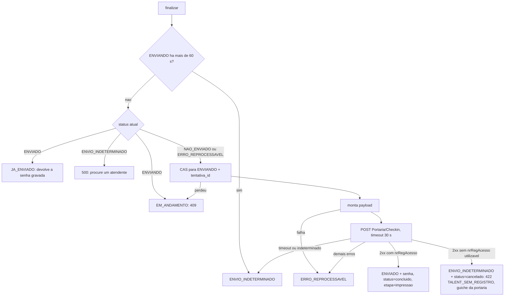

# 07 - Check-in no Talent

Índice: [fluxos](README.md) | API: [totem-api-interna](../apis/totem-api-interna.md), [talent-checkin](../apis/talent-checkin.md) | [regras de negócio](../regras-negocio.md) | [banco de dados](../banco-dados.md)

Legenda de confiança: ver [README](README.md#legenda-de-confiança).

## Objetivo

Enviar o check-in do atendimento ao Talent WMS (`atendimento.php?acao=finalizar`) e obter a senha de acesso (`nrRegAcesso`). `[CÓDIGO]`

## Atores

Motorista; backend (`AtendimentoController::finalizar`, `TalentRn`, `TalentClient`); Talent `[AMBIENTE-TERCEIRO]`; telas `*_impressao` (`impressao.js`).

## Pré-condições (nesta ordem)

1. Tipo válido e atendimento `em_andamento`. `[CÓDIGO]`
2. Etapa `exp_confirmacao`/`rec_confirmacao`.
3. CNH e CRLV aprovados.
4. RNTRC e tipo de veículo não vazios (senão 422 `CONFIRMACAO_INCOMPLETA`).
5. Totem com empresa ATIVA (senão 500 "Totem sem empresa/armazém configurado").
6. Recebimento: todas as notas com `numero_nota` (422 `NOTAS_SEM_NUMERO`). Expedição: `ordem_coleta` não vazia (422).
7. `TALENT_CHECKIN_ATIVO` exatamente `true` (senão 503 `TALENT_CHECKIN_DESATIVADO`, fail-closed). Padrão em `.env.example`: `false`. Produção: `true`, confirmado pelo responsável do projeto em 2026-10-10. `[AMBIENTE-TERCEIRO]`

**Divergência registrada:** um registro anterior diz que `finalizar` exigiria também o cliente no Recebimento. No código, só a confirmação (`camposObrigatoriosAusentes`) exige `cliente_nome`; o `finalizar` não checa. O CNPJ do depositante é validado ao montar o payload (falha => `ERRO_REPROCESSAVEL`/`erro_montagem_payload`).

## Etapas do motorista

Depois da confirmação e da resposta sobre ajudante, a tela `*_impressao` mostra "enviando" e chama `finalizar`. Em sucesso segue para a impressão ([08](08-impressao-etiquetas.md)). Se o Talent responder 2xx sem número de registro (422 `TALENT_SEM_REGISTRO`), o motorista vê a tela "Nao foi possivel concluir seu check-in. / Dirija-se ao guichê da portaria." com um único botão "Voltar ao início", sem retry (ver [08](08-impressao-etiquetas.md)). Em erro, o motorista vê a mensagem e o botão "Tentar novamente" (nova chamada a `finalizar`). Pode corrigir o ajudante se a recusa citar o ajudante. `[CÓDIGO]`

## Processamento interno (`TalentRn::processarCheckin`)

- **CAS** `iniciarEnvioTalent` (`NAO_ENVIADO`/`ERRO_REPROCESSAVEL` -> `ENVIANDO`, com `talent_tentativa_id` novo). Sem `GET_LOCK`. `[CÓDIGO]`
- **Payload:** `cnpjArmazem` (da empresa do totem, nunca do front), `cnpjDepositante` (cliente do atendimento, 14 dígitos), `tipoEmbDesemb` (Embarque na Expedição, Desembarque no Recebimento), `veiculo{placa,uf,rntc,tipo}`, `motorista{cpf,nome}`, `ajudantes[{cpf,nome}]` só se há ajudante, `doctos[]` (Expedição: `ORDEM_COLETA` com o número da OC; Recebimento: um `NOTA_FISCAL` por nota), `anexos[]` em base64 puro (PDF de cada nota "Nota Fiscal NN"; PDF "Ordem de Coleta" quando existir, ver [10](10-anexo-ordem-coleta-n8n.md); falha do anexo da OC segue sem anexo, só `error_log`). Não enviamos `pager`. A chave de acesso da nota é sempre nula (P26). `[CÓDIGO]`
- **Cliente HTTP:** `POST {TALENT_API_URL}/Portaria/Checkin`, `Authorization: Bearer`, JSON UTF-8, timeout 30 s. `[CÓDIGO]` `[AMBIENTE-TERCEIRO]`
- **Resultado:** 2xx com `nrRegAcesso` utilizável (texto com `trim() !== ''`) grava `ENVIADO` com `senha = nrRegAcesso`, `status=concluido`, `etapa=impressao`. **2xx sem `nrRegAcesso` utilizável** (ausente, nulo, não-texto, vazio ou só espaços, corpo não-JSON ou não-array, 204) lança `resposta_ilegivel`: o atendimento é **cancelado** (decisão do usuário em 2026-10-11; ver abaixo). `timeout`/`erro_indeterminado` => `ENVIO_INDETERMINADO`. Demais categorias (400, 401, 404, 409, 500, conexão, HTTP) => `ERRO_REPROCESSAVEL`. `[CÓDIGO]`
- **2xx sem número de registro (`TALENT_SEM_REGISTRO`):** `TalentRn` chama `AtendimentoDao::cancelarPorRespostaSemRegistroTalent` (CAS por `talent_tentativa_id` + `ENVIANDO` + `status != 'concluido'`): grava `ENVIO_INDETERMINADO` e `status=cancelado` só se estava `em_andamento` (não sobrescreve `bloqueado`/`concluido`). O controller registra o log `talent_indeterminado` (`categoria_erro=resposta_ilegivel`) e o `error_log` `checkin_talent_sem_registro_cancelado`, move as fotos das notas para a quarentena e responde 422 `TALENT_SEM_REGISTRO` (`dados.acao=guiche_portaria`, `tentar_novamente=false`, sem senha). Na Expedição a OC **não** é baixada (segue ATIVA). A 2ª chamada de `finalizar` responde 400 `Atendimento nao esta em andamento`, sem novo POST. Se o CAS perder uma corrida (ajuste do ajudante em andamento por outro processo), o motorista recebe o mesmo 422, as fotos não são quarentenadas e o log é gravado. O Talent pode ter registrado o check-in sem devolver senha: a portaria localiza o caso pelo `tb_log_sistema`. `[CÓDIGO]`
- **Resposta ao front:** `ENVIADO`/`JA_ENVIADO` => 200 com senha e protocolo nulo; `SEM_REGISTRO_CANCELADO` => **422** `TALENT_SEM_REGISTRO`; `EM_ANDAMENTO` => 409; `ENVIO_INDETERMINADO` e `INDETERMINADO_PENDENTE_MANUAL` => 500 "Não foi possível confirmar seu check-in, procure um atendente" (+ log `talent_indeterminado`); `ERRO_REPROCESSAVEL` => **HTTP 202 com `sucesso=false`**, texto fixo por categoria e, se o Talent mandou motivo, `dados.mensagem_api` sanitizado (300 caracteres, nunca logado nem persistido). Uma linha de log por chamada. `[CÓDIGO]`
- Sem reenvio automático nem fila (removida em 2026-10-05): nova tentativa só manual ("Tentar novamente"). `[CÓDIGO]`
- **Correção do ajudante:** o front mostra "Corrigir dados do ajudante" só quando a `mensagem_api` normalizada contém "ajudante" (critério frágil, P49); reutiliza `salvar-etapa ajudante`, aceito só com `NAO_ENVIADO`/`ERRO_REPROCESSAVEL` (senão 409). `[CÓDIGO]`
- Após `ENVIADO`/`JA_ENVIADO` na Expedição roda a baixa da OC ([06](06-consulta-e-baixa-ordem-coleta.md)). `[CÓDIGO]`

## Endpoints envolvidos

`atendimento.php?acao=finalizar` e `salvar-etapa` (ajudante). Externo: `Portaria/Checkin` do Talent, ver [talent-checkin](../apis/talent-checkin.md). Ver [totem-api-interna](../apis/totem-api-interna.md).

## Mudanças de estado

`talent_checkin_status`: `NAO_ENVIADO` -> `ENVIANDO` -> `ENVIADO` | `ERRO_REPROCESSAVEL` | `ENVIO_INDETERMINADO`. `ENVIADO` => `status=concluido` (terminal), `etapa=impressao`, `talent_senha` gravada. `ENVIO_INDETERMINADO` por resposta 2xx sem número => `status=cancelado` (sem senha). `[CÓDIGO]`

## Integrações

Talent WMS. Contrato em `docs/manual_talent.md` (sucesso com `nrRegAcesso`/`msg`; 409 confirmado empiricamente em 2026-09-15; corpo de erro 400 real não documentado, P48). Teste real de 2026-09-14 OK. `[AMBIENTE-TERCEIRO]`

## Conclusão

`ENVIADO` com senha; o atendimento passa a `concluido` e a senha é impressa ([08](08-impressao-etiquetas.md)).

## Cancelamento

`cancelar` não consulta `talent_checkin_status`: um cancelamento entre o CAS `ENVIANDO` e a gravação do resultado não é impedido, e o `ENVIADO` posterior sobrescreve o status (a gravação filtra por `id_atendimento` + `talent_tentativa_id`, sem exigir `em_andamento`). Nenhum teste encontrado cobre esse cruzamento. Registrado sem correção. Ver [09](09-cancelamento-e-abandono.md). `[CÓDIGO]`

## Falhas e alternativas

- `ERRO_REPROCESSAVEL`: mensagem + "Tentar novamente".
- `EM_ANDAMENTO`: aguardar/tentar de novo.
- 2xx sem número de registro: atendimento cancelado, tela do guichê da portaria (sem retry).
- `ENVIO_INDETERMINADO` por timeout/falha de rede: **sem saída no código** (ver pendências).
- Flag desligada: 503 fail-closed.

## Pendências

- **`ENVIO_INDETERMINADO` sem saída (timeout/falha de rede):** nenhuma tela ou rotina o resolve; o cron de abandono só considera `NAO_ENVIADO`/`ERRO_REPROCESSAVEL`; a Gestão não tem tela de atendimentos. O atendimento fica `em_andamento` indefinidamente e o motorista é orientado a procurar um atendente. Reabertura de concluído não planejada. Registrado sem correção. O caso "2xx sem número de registro" está **resolvido** (cancelado + guichê).
- **Só o log identifica o caso 2xx sem número:** o atendimento cancelado por este ramo fica `cancelado` + `ENVIO_INDETERMINADO`, indistinguível de timeout seguido de `cancelar` a não ser pelo `tb_log_sistema` (`categoria_erro=resposta_ilegivel`); não há campo próprio. Pendência de baixa severidade.
- **Cancelar durante o envio** sem proteção (acima).
- **`finalizar` não exige cliente** no Recebimento (acima).
- Chave de acesso sempre nula (P26); corpo de erro 400 do Talent (P48); critério do ajudante (P49); P65 (Nr. Pager retirado).
- `teste_talent_payload` 41/45 e `teste_talent_anexos_pdf` 15/19 (P55); `teste_concorrencia_finalizar_checkin` e `teste_talent_idor_finalizar` só passam com a flag diferente de `true` (P55).
