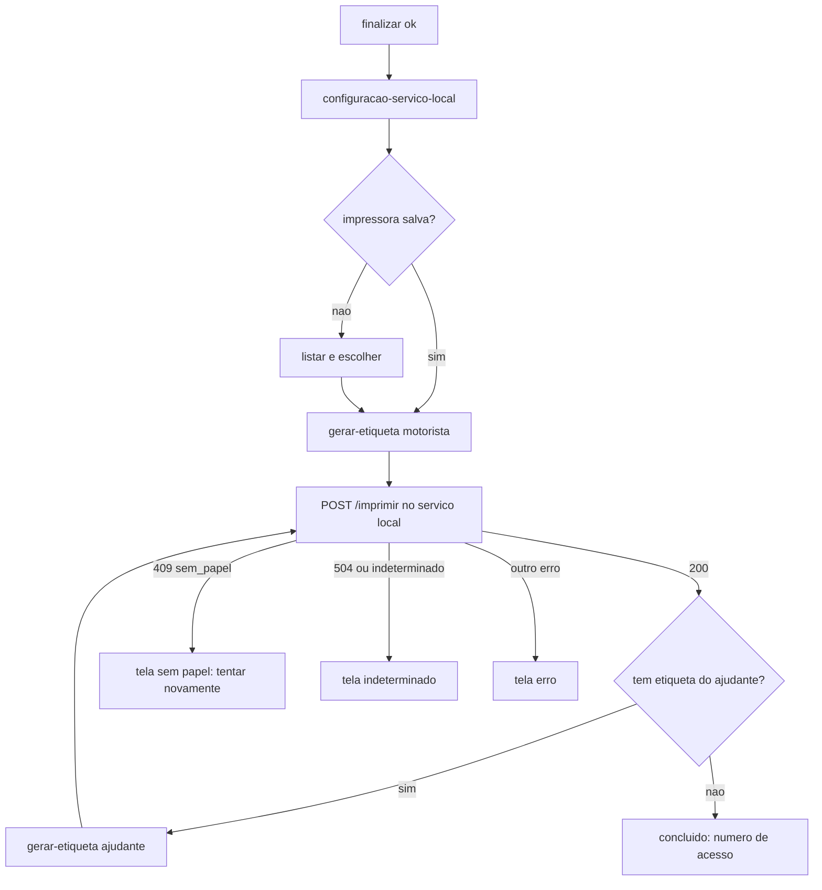

# 08 - Impressão de etiquetas

Índice: [fluxos](README.md) | API: [totem-api-interna](../apis/totem-api-interna.md), [impressao-servico-local](../apis/impressao-servico-local.md) | [regras de negócio](../regras-negocio.md) | [banco de dados](../banco-dados.md)

Legenda de confiança: ver [README](README.md#legenda-de-confiança).

## Objetivo

Depois do check-in, gerar a etiqueta do motorista (e a do ajudante, se houver) como PDF no backend e imprimi-la pelo serviço local de impressão do mini PC, mostrando o "Número de acesso" ao motorista. `[CÓDIGO]`

## Atores

Motorista; `impressao.js` (front); backend (`ImpressaoAtendimentoController`, `EtiquetaLayout`, `TextoEtiqueta`, `ConfiguracaoServicoImpressao`); serviço local Node (`servico-impressao-local/`) em 127.0.0.1; impressora `[AMBIENTE-TERCEIRO]`.

## Pré-condições

Check-in `ENVIADO` ([07](07-checkin-talent.md)). `gerar-etiqueta` só responde com `status=concluido`, `talent_checkin_status=ENVIADO` e `talent_senha` não vazia, senão 409. `[CÓDIGO]`

## Etapas do motorista

1. `exp_impressao`/`rec_impressao`: tela "enviando" (o `finalizar` do [07](07-checkin-talent.md)). Erro de finalização: subtela com "Tentar novamente".
2. O front busca a configuração do serviço local (`impressao.php?acao=configuracao-servico-local`); falha => 503 `impressao_config_falhou`.
3. Impressora: usa a salva em `localStorage` (`totem_impressora_nome`); se não houver, lista `/impressoras` do serviço e pede a escolha ("selecionar impressora").
4. Para cada etiqueta: `gerar-etiqueta` no backend e POST `/imprimir` no serviço local. Ordem: motorista; se `tem_etiqueta_ajudante`, imprime a do ajudante em seguida. A tela de concluído só aparece após as duas. "Tentar novamente" reimprime só a pendente.
5. Tela final: "Número de acesso" (a senha `nrRegAcesso`) e o nome do motorista, com "Imprimir novamente" e "Novo atendimento". `[CÓDIGO]`

Subtelas de `impressao.js`: enviando, erro de finalização, **guichê da portaria**, selecionar impressora, preparando, imprimindo, concluído, erro, indeterminado, sem papel. `[CÓDIGO]`

### Tela do guichê da portaria (`guiche_portaria`)

Alternativa à tela final, para Expedição e Recebimento. Aparece quando `finalizar` responde 422 `TALENT_SEM_REGISTRO` (o Talent respondeu 2xx sem número de registro; atendimento cancelado, ver [07](07-checkin-talent.md)). `[CÓDIGO]`

- Título "Não foi possível concluir seu check-in." e texto "Dirija-se ao guichê da portaria." (com acentos na tela), mais um único botão "Voltar ao início".
- Sem "Tentar novamente", sem correção do ajudante e sem impressão (nenhuma etiqueta é gerada). A barra "Cancelar atendimento" fica oculta e `cancelar` nunca é chamado (o atendimento já está cancelado).
- Uma segunda chamada de `finalizar` (400, 500 ou 422) mantém a tela. Depois de 180 s de inatividade o totem volta ao início **sem o aviso** "Ainda está aí?" e sem chamar `cancelar`.
- Teste de layout: `tests/manual/vio_captura_layout.js` (cobre a tela; contagem histórica no [plano de testes](../plano-testes.md)).

## Processamento interno

### Backend (`impressao.php?acao=gerar-etiqueta`)

- `destinatario` em `motorista` (padrão) ou `ajudante`; ajudante exige `possui_ajudante=1` e nome, senão 409. `[CÓDIGO]`
- Nome e número passam por `TextoEtiqueta::paraAscii` (somente ASCII 0x20-0x7E, sem acento). A etiqueta traz "UDLOG" (ou "AJUDANTE"), nome, número de acesso (60 pt) e "Gerado em"; **nunca CPF**. `[CÓDIGO]` `[TESTE: teste_etiqueta_ajudante, teste_texto_etiqueta]`
- Configuração no `.env` (`ETIQUETA_LARGURA_MM`, `ETIQUETA_COMPRIMENTO_MM`, `ETIQUETA_ORIENTACAO`, `ETIQUETA_CORTE_APOS_IMPRESSAO`); inválida => 500 + log `etiqueta_config_invalida`. Padrão 80x80 mm. PDF FPDF de 1 página (`EtiquetaLayout`, área útil 48 mm a partir de 1 mm, fontes com redução automática). `[CÓDIGO]`
- Resposta: `pdf_base64`, `identificador` (hex de 32), dimensões, `destinatario` e `tem_etiqueta_ajudante` (só no motorista). `[CÓDIGO]`
- A posse do atendimento é validada (404 para outro totem). `[TESTE: teste_impressao_idor]`

### Serviço local (`POST /imprimir`) `[AMBIENTE-TERCEIRO]`

Escuta só em 127.0.0.1; token (mínimo 16 caracteres), allowlist obrigatória de impressoras, CORS/PNA por `origensPermitidas`. Valida o corpo (impressora sem barras; `identificador` de 1 a 128 caracteres `A-Za-z0-9_-`). Idempotência **em memória** por `identificador` (impresso => 200 `ja_impresso`; indeterminado => 200 `indeterminado`). PDF válido, mutex de 1 job (503 se ocupado), timeout (`timeoutMs`, padrão 30000; estouro => 504 `indeterminado`). Com `deteccaoSemPapel` (padrão true; `semPapelTimeoutMs` padrão 10000, faixa 3000-60000) verifica a fila do spooler: job retido => remove só o job e responde **409 `sem_papel`**. `[CÓDIGO]` `[TESTE: servico-impressao-local/tests/*.test.js, não reexecutado]` Detalhes em [impressao-servico-local](../apis/impressao-servico-local.md).

### Sem papel no front

Alerta "Falta de papel na impressora. Chame o atendimento." e "Tentar novamente" sem limite; a inatividade fica suspensa nessa tela e em `erro`, `indeterminado` e `erro_finalizar` (ver [09](09-cancelamento-e-abandono.md)). `[CÓDIGO]`

## Endpoints envolvidos

`impressao.php` (`gerar-etiqueta`, `configuracao-servico-local`); serviço local (`/impressoras`, `/imprimir`); diagnóstico `impressao-teste.php` (exige token do totem; aberto por toque num hotspot oculto da `home`, mantido por decisão do usuário, P28). Ver [totem-api-interna](../apis/totem-api-interna.md).

## Mudanças de estado

Nenhuma no banco: o atendimento já está `concluido`/`impressao`. O estado de impressão vive só no front (e na memória do serviço local). `[CÓDIGO]`

## Integrações

Serviço local Node e impressora. Detecção de papel validada só para EPSON TM-T88VII segundo o state; sucesso do spooler não confirma impressão física e outras falhas físicas não são detectadas (P27). `[AMBIENTE-TERCEIRO]`

## Conclusão

Etiqueta(s) impressa(s) e tela com o número de acesso; "Novo atendimento" zera o estado e volta a `lgpd`. Se o Talent não devolver número de registro, não há etiqueta: o motorista vê a tela do guichê da portaria e "Voltar ao início".

## Cancelamento

Após `concluido`, cancelar retorna 409. A tela final oferece "Imprimir novamente" e "Novo atendimento". Ver [09](09-cancelamento-e-abandono.md).

## Falhas e alternativas

`sem_papel`, `indeterminado`, `erro` e erro de finalização têm subtelas com nova tentativa. Config do serviço indisponível: 503. Impressora não escolhida: seleção manual.

## Pendências

- P27 (falhas físicas não detectadas), P28 (diagnóstico), P30/P31/P46 (produção), P47, P54.
- O repositório ainda contém `scripts/instalar-servico-windows.js` e `desinstalar-servico-windows.js` (legado) ao lado da tarefa de logon, enquanto o state diz que o serviço Windows foi descartado. Registrado sem correção.
