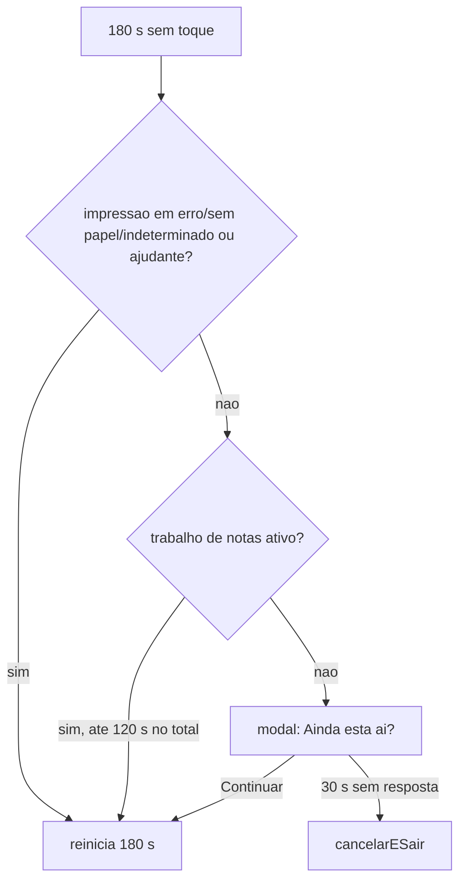

# 09 - Cancelamento, inatividade e abandono

Índice: [fluxos](README.md) | API: [totem-api-interna](../apis/totem-api-interna.md) | [regras de negócio](../regras-negocio.md) | [banco de dados](../banco-dados.md)

Legenda de confiança: ver [README](README.md#legenda-de-confiança).

## Objetivo

Encerrar atendimentos que o motorista desiste (botão), que ficam parados (aviso de inatividade) ou que são esquecidos (cron de abandono), preservando atendimentos concluídos e tratando as fotos das notas. `[CÓDIGO]`

## Atores

Motorista; `app.js` (cancelar e inatividade); `AtendimentoController::cancelar`; `AbandonoAtendimentoRn` e `cron/abandonar-atendimentos.php`; `NotaArquivoStorage` e `cron/limpar-notas-quarentena.php`.

## Pré-condições

Atendimento existente. O botão e o aviso não existem em `home` e `lgpd`. `[CÓDIGO]`

## Etapas do motorista

### Cancelar atendimento

1. A barra "Cancelar atendimento" aparece em toda tela exceto `home` e `lgpd`. Os modais do número da nota e de reprovação de documento têm atalho próprio de cancelar.
2. O toque abre um modal de confirmação.
3. Confirmado, o front chama `atendimento.php?acao=cancelar` **ignorando qualquer erro da resposta**, e então `novoAtendimento()` volta a `lgpd` e zera o estado em memória. `[CÓDIGO]`

### Inatividade (180 s + 30 s)

- Constantes: `IDLE_MS=180000`, `IDLE_ABANDONO_MS=30000`, `INATIVIDADE_TETO_SUSPENSAO_MS=120000`. `[CÓDIGO]`
- O temporizador não é armado em `home` e `lgpd`; reinicia com `click`, `touchstart`, `keydown` (ignorado com o aviso aberto) e a cada troca de tela. `[CÓDIGO]`
- Ao vencer 180 s: (a) se a impressão está em `sem_papel`/`erro`/`indeterminado`/`erro_finalizar` ou há correção do ajudante, só reinicia os 180 s (inatividade suspensa); (b) se há trabalho de notas ativo (captura, OCR, fila, identificação), adia até 120 s no total; (c) caso contrário abre o modal "Ainda está aí?" com "Continuar" e arma 30 s.
- Na tela do guichê da portaria (2xx sem número de registro, [08](08-impressao-etiquetas.md)) a inatividade de 180 s volta ao início **sem o aviso** e sem chamar `cancelar` (o atendimento já está cancelado). `[CÓDIGO]`
- Se o motorista não toca em 30 s, chama `cancelarESair()` (cancela e volta a `lgpd`). O aviso nunca reseta sozinho sem o prazo e nunca espera indefinidamente. `[CÓDIGO]` `[TESTE: vio_captura_layout.js]`

## Processamento interno

### `cancelar` (backend)

- Valida só a posse (totem do token). UPDATE para `cancelado` onde `status` é diferente de `concluido`; se nada mudou, devolve sucesso quando o status atual não é `concluido` (idempotente; já cancelado/bloqueado também retorna sucesso). `concluido` => 409. `[CÓDIGO]` `[TESTE: _caso_cancelar, teste_integridade_conclusao_atendimento]`
- Depois move as fotos das notas para quarentena (best effort; falha só em log). `[CÓDIGO]`
- **Não verifica a etapa nem `talent_checkin_status`:** cancelar durante o envio ao Talent não é impedido (ver [07](07-checkin-talent.md)). Registrado sem correção.
- **Cancelamento pelo servidor no `finalizar`:** quando o Talent responde 2xx sem número de registro, `AtendimentoDao::cancelarPorRespostaSemRegistroTalent` grava `status=cancelado` (só se estava `em_andamento`) com `talent_checkin_status=ENVIO_INDETERMINADO`, e o controller move as fotos das notas para a quarentena como no `cancelar`. O front **não** chama `cancelar` nessa tela. Na Expedição a OC não é baixada. Ver [07](07-checkin-talent.md). `[CÓDIGO]`
- `bloquear-excesso-notas` (Recebimento >5 notas): `status=bloqueado`, `etapa=balcao_portaria`; não exige etapa nem `em_andamento`; `concluido` => 409. Pode converter `cancelado` em `bloqueado`. `[CÓDIGO]`

### Quarentena das fotos

`NotaArquivoStorage` renomeia `nota_NN.jpg` para `nota_NN.jpg.<id_nota>.del` (quarentena) em vez de apagar de imediato. O cron `limpar-notas-quarentena.php` apaga os `.del` com mais de 24 h (86400 s), só caminhos válidos por regex, ignorando symlinks, até 500 remoções por execução. Rollback de operações restaura a foto. `[CÓDIGO]` `[TESTE: teste_hardening_cron_quarentena, teste_hardening_r4_storage_cron]`

### Cron de abandono (`cron/abandonar-atendimentos.php`)

- Considera `em_andamento` com `talent_checkin_status` `NAO_ENVIADO` ou `ERRO_REPROCESSAVEL` e inatividade de 86400 s (24 h) ou mais, usando o maior entre `atualizado_em` e a atividade das notas. Lote de 500. `[CÓDIGO]`
- Por atendimento, em transação com `FOR UPDATE` e nova checagem: move as fotos das notas para quarentena e marca `status=cancelado`; em falha, restaura as fotos. `[CÓDIGO]` `[TESTE: teste_hardening_r4_abandono]`
- **Não atua** em `ENVIANDO`, `ENVIADO` e `ENVIO_INDETERMINADO`. Atendimentos em `ENVIO_INDETERMINADO` por timeout/falha de rede ficam `em_andamento` para sempre (o caso "2xx sem número de registro" já nasce `cancelado`). `[CÓDIGO]`
- CLI-only; grava `LogSistema cron_resumo`/`cron_falhou`; `exit(1)` em falha.
- Agendas registradas (produção, fuso -03): abandono 03:15; quarentena 03:30; anexos de OC 03:55; rate limit do OCR a cada hora cheia. Agendamento real no cPanel: `[AMBIENTE-TERCEIRO]`.

## Endpoints envolvidos

`atendimento.php` (`cancelar`, `bloquear-excesso-notas`). Crons são CLI, sem endpoint. Ver [totem-api-interna](../apis/totem-api-interna.md).

## Mudanças de estado

`em_andamento` -> `cancelado` (botão, inatividade ou cron) ou `bloqueado` (>5 notas). `concluido` é terminal: cancelar/bloquear => 409. Fotos: `nota_NN.jpg` -> `.del` -> removido em 24 h. `[CÓDIGO]`

## Integrações

Sistema de arquivos em `STORAGE_PATH`; cron do cPanel `[AMBIENTE-TERCEIRO]`.

## Conclusão

Atendimento `cancelado` e fotos em quarentena ou removidas. O front volta a `lgpd`.

## Cancelamento

Este próprio fluxo. Polls e uploads obsoletos são descartados por `pollGeracao`/`atendimentoGeracao`. `[CÓDIGO]`

## Falhas e alternativas

- Falha da API no `cancelar`: ignorada pelo front; o atendimento pode permanecer `em_andamento` até o abandono de 24 h (se elegível).
- Falha ao mover fotos: log apenas; o cron de abandono ou o de quarentena cobre quando aplicável.
- Atendimento órfão em `placa` (consulta de OC sem resultado) é tratado por cancelar ou abandono.

## Pendências

- **Retenção das fotos de notas de atendimentos concluídos** (decisão de produto em 2026-10-10: não será tratado): comportamento atual, abandono só atua em `em_andamento` e a quarentena só apaga `.del`.
- `ENVIO_INDETERMINADO` sem saída (timeout/falha de rede; o caso 2xx sem número está resolvido) e `cancelar` durante o envio sem proteção (fluxo 07).
- Nenhuma rotina remove `tb_lgpd_aceite` (decisão de produto em 2026-10-10: não será tratado; fluxo 01).
- O `limpar-logs-gestao.php` (04:10) e os demais crons estão agendados e executando em produção (confirmado pelo responsável do projeto em 2026-10-10).
- P04 (guard de `idAtendimento` após `await`) aberta.
