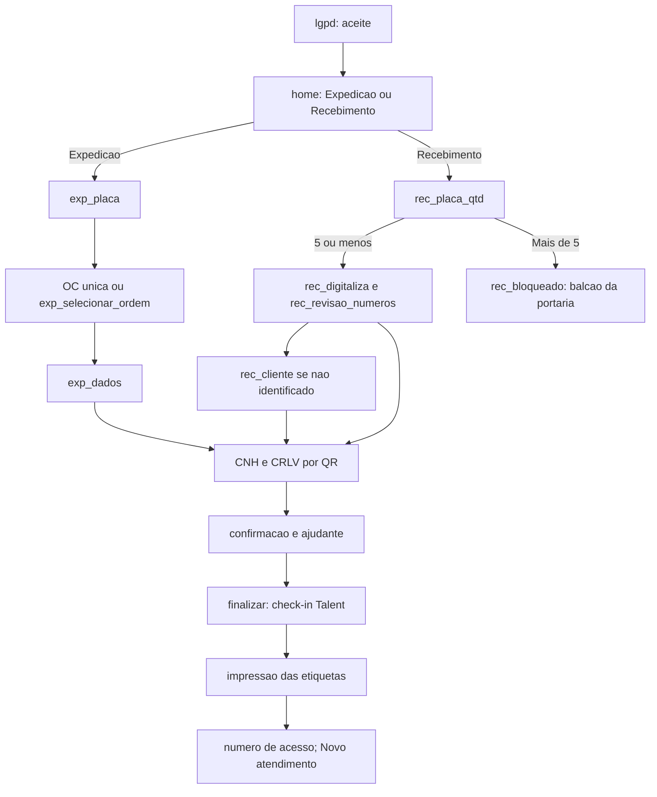

# Fluxos do totem-udlog

Documentação dos fluxos reais do sistema, conferida contra o código (HEAD `4188fee`). O código vence qualquer outro documento. Nenhum teste foi reexecutado para escrever esta documentação: marcas `[TESTE: nome]` indicam que existe teste cujo escopo cobre a regra, e que o resultado "passa" só é conhecido por registro histórico.

## Legenda de confiança

| Marca | Significado |
|---|---|
| `[CÓDIGO]` | Confirmado lendo o código (arquivo e função citados). |
| `[TESTE: nome]` | Existe teste em `tests/manual/` ou no serviço de impressão que cobre a regra. Não reexecutado nesta documentação. |
| `[AMBIENTE-TERCEIRO]` | Depende de ambiente ou terceiro (Talent, vio.api.br, n8n, banco externo, Hostgator, mini PC, impressora, scanner Netum). Não verificável só pelo repositório. |
| `[PENDENTE DE CONFIRMAÇÃO]` | Não há evidência suficiente no código ou na documentação. Não deve ser tratado como fato. |

Documentos relacionados (escritos em paralelo): [regras de negócio](../regras-negocio.md), [banco de dados](../banco-dados.md), [API interna do totem](../apis/totem-api-interna.md) e demais arquivos em `../apis/`.

## Índice dos fluxos

Atendimento do motorista (quiosque):

1. [01 - LGPD e início do atendimento](01-lgpd-e-inicio-atendimento.md)
2. [02 - Expedição](02-expedicao.md)
3. [03 - Recebimento](03-recebimento.md)
4. [04 - Notas fiscais e OCR](04-notas-e-ocr.md)
5. [05 - CNH, CRLV, QR e vio.api.br](05-cnh-crlv-qr-vio.md)
6. [06 - Consulta e baixa de ordem de coleta](06-consulta-e-baixa-ordem-coleta.md)
7. [07 - Check-in no Talent](07-checkin-talent.md)
8. [08 - Impressão de etiquetas](08-impressao-etiquetas.md)
9. [09 - Cancelamento, inatividade e abandono](09-cancelamento-e-abandono.md)
10. [10 - Anexo da ordem de coleta (n8n)](10-anexo-ordem-coleta-n8n.md)

Gestão (painel web da UDLOG, fora do quiosque):

11. [11 - Gestão: acesso e usuários](11-gestao-acesso-e-usuarios.md)
12. [12 - Gestão: totens](12-gestao-totens.md)
13. [13 - Gestão: logs e auditoria](13-gestao-logs-auditoria.md)
14. [14 - Gestão: ordens de coleta](14-gestao-ordens-coleta.md)
15. [15 - Gestão: clientes e empresas](15-gestao-clientes-empresas.md)

## Visão geral do atendimento do motorista

O motorista chega ao totem (Chromium em modo quiosque, tela retrato), aceita o Aviso de Privacidade, escolhe Expedição ou Recebimento, informa a placa e segue por etapas até receber a senha ("Número de acesso") e a(s) etiqueta(s) impressa(s). Depois, aguarda ser chamado. `[CÓDIGO]`

Resumo por fluxo:

- [01](01-lgpd-e-inicio-atendimento.md): aceite com token de uso único e criação do atendimento.
- [02](02-expedicao.md) e [03](03-recebimento.md): sequência de telas e etapas de cada tipo.
- [04](04-notas-e-ocr.md): foto das notas (Recebimento), OCR no navegador, identificação do cliente.
- [05](05-cnh-crlv-qr-vio.md): leitura do QR de CNH e CRLV e validação na vio.api.br.
- [06](06-consulta-e-baixa-ordem-coleta.md): busca da OC por placa e baixa após o check-in (Expedição).
- [07](07-checkin-talent.md): envio ao Talent e a senha de acesso.
- [08](08-impressao-etiquetas.md): etiquetas do motorista e do ajudante pelo serviço local de impressão.
- [09](09-cancelamento-e-abandono.md): cancelar, aviso de inatividade, cron de abandono e quarentena das fotos.
- [10](10-anexo-ordem-coleta-n8n.md): PDF da OC recebido do n8n e anexado ao check-in.

## Mapa de telas e estados do front

O estado vive em `state.tela` (`ir()` e `renderTela()` em `public/totem/assets/app.js`). `renderTela` tem **26 casos** (contagem conferida no código). `[CÓDIGO]`

| Grupo | Telas |
|---|---|
| Comuns (2) | `lgpd`, `home` |
| Expedição (11) | `exp_placa`, `exp_selecionar_ordem`, `exp_dados`, `exp_cnh_qr`, `exp_cnh_manual`, `exp_crlv_qr`, `exp_crlv_manual`, `exp_aguarde_documentos`, `exp_confirma`, `exp_ajudante`, `exp_impressao` |
| Recebimento (13) | `rec_placa_qtd`, `rec_bloqueado`, `rec_digitaliza`, `rec_revisao_numeros`, `rec_cliente`, `rec_cnh_qr`, `rec_cnh_manual`, `rec_crlv_qr`, `rec_crlv_manual`, `rec_aguarde_documentos`, `rec_confirma`, `rec_ajudante`, `rec_impressao` |

Observações `[CÓDIGO]`:

- `rec_cnh` e `exp_cnh`/`exp_crlv` são nomes de **etapa do backend** (`tb_atendimento.etapa_atual`), não de tela; o front os mapeia para as telas `*_cnh_qr` e `*_crlv_qr`.
- A barra "Cancelar atendimento" aparece em toda tela exceto `home` e `lgpd`.
- O aviso de inatividade não é armado em `home` e `lgpd`.
- Dentro de `exp_impressao`/`rec_impressao` há subtelas próprias de `impressao.js` (enviando, erro de finalização, guichê da portaria, selecionar impressora, preparando, imprimindo, concluído, erro, indeterminado, sem papel); veja o fluxo 08.
- Tela `novoAtendimento()` volta a `lgpd` e zera o estado em memória; não existe retomada ao recarregar a página.

Etapas do backend (`etapa_atual`) e status `[CÓDIGO]`: `placa`, `dados_encontrados`, `exp_cnh`, `exp_crlv`, `exp_aguarde_documentos`, `exp_confirmacao`, `digitalizacao_notas`, `cliente`, `rec_cnh`, `rec_crlv`, `rec_aguarde_documentos`, `rec_confirmacao`, `impressao`, `balcao_portaria`. Status: `em_andamento`, `concluido` (terminal), `cancelado`, `bloqueado`.

## Divergências e pendências transversais (registradas, sem correção)

- **26 telas**: o front tem 26 casos em `renderTela` e nenhuma tela `rec_cnh` (`rec_cnh` existe só como etapa de backend). A referência anterior a "27 estados" foi corrigida para 26.
- **Rotação de 270 graus**: um registro anterior dizia que a rotação é só na cópia do OCR; no código atual a rotação é aplicada no canvas de captura e o mesmo JPEG serve à prévia, ao upload e ao OCR (fluxo 04).
- **Papel emitente/destinatário** do CNPJ: decisão registrada, NÃO implementada (fluxo 04).
- **`finalizar` não exige cliente no Recebimento**: só a tela de confirmação exige (fluxos 03 e 07).
- **Talent `ENVIO_INDETERMINADO`** (timeout/falha de rede) sem saída e `cancelar` durante o envio sem proteção (fluxos 07 e 09). O caso "Talent 2xx sem `nrRegAcesso`" foi **resolvido** em 2026-10-11 (atendimento cancelado e tela do guichê da portaria; fluxos 07, 08 e 09).
- **Retenção** (decisão de produto em 2026-10-10: não será tratado): comportamento atual, nenhuma rotina remove `tb_lgpd_aceite` nem as fotos de notas de atendimentos concluídos (fluxos 01, 04 e 09).
- **`CONCLUIR_EXIGE_NUMERO_NOTA`** tem padrão `false` em `.env.example`; em produção está `true`, conferido em 2026-10-16 (fluxo 04).
- **Edições em `exp_dados`** não são persistidas (fluxo 02).
- **Sem limite de re-escaneio no backend** (P52; fluxo 05).
- Registros anteriores ainda descrevem migrations e "retenção hoje SEM poda" como pendentes; migrations foram removidas e `cron/limpar-logs-gestao.php` existe. Fora do escopo dos fluxos do motorista.
